# Roadmap Final Rekam Medis Veteriner PetHeal

Dokumen ini adalah **roadmap final** yang menggantikan versi kerja sebelumnya.
Isinya menjadi dasar persetujuan sebelum implementasi kode dimulai.

- Versi: final-1.3 (revisi terarah dari final-1.0 sampai final-1.2)
- Tanggal: 26 November 2026
- Perubahan utama: sumber kebenaran relasi booking, pointer versi aktif,
  pemisahan kewenangan amendment klinis, pemisahan emergency dari kredensial,
  kelengkapan `clinic_id`, penguatan audit, farmasi, lab, inpatient, API, dan
  fase implementasi granular P0.1–P4. Final-1.2 menutup inkonsistensi status
  default, finalisasi admin, snapshot hash, audit akses, status laboratorium
  lama, dan metadata legal hold. Final-1.3 menutup hierarki master data,
  kardinalitas rawat inap, single pending amendment, kontrak error, serializer
  pemilik, race condition, kebijakan drift, supervisi paramedik, timezone,
  soft delete, rollback, monitoring, dan dual approval legal hold.
- Lingkup: backend Laravel, basis data, web admin, portal dokter, dan kontrak API Android.
- Status: **menunggu persetujuan. Belum ada implementasi kode.**
- Dasar pemeriksaan: skema database `pet_heal` yang benar-benar berjalan,
  migration, model, controller, route, test, serta teks resmi Permentan 3/2019
  dan Permentan 34/2025.

> Catatan penting: dokumen ini adalah rancangan teknis dan pemetaan kepatuhan,
> bukan nasihat hukum, bukan sertifikasi, dan bukan klaim bahwa PetHeal sudah
> terintegrasi dengan iSIKHNAS. Setiap klaim integrasi resmi harus memiliki
> bukti dari instansi berwenang.

---

## 0. Keputusan yang mengikat

1. Status rekam medis hanya lima: `draft`, `in_review`, `final`, `void`,
   `archived`.
2. `amended` **bukan status rekam medis**. Koreksi setelah final memakai
   mekanisme **amendment + versioning**.
3. Dokumen final tidak boleh dihapus dan tidak boleh ditimpa tanpa jejak.
4. Satu booking tetap satu rekam medis. Unique index lama dipertahankan.
5. Satu encounter dapat memiliki banyak catatan perkembangan klinis dan banyak
   pengukuran vital. Catatan perkembangan bukan rekam medis baru.
6. `booking_id` tidak dihapus. Nilainya boleh menjadi nullable agar walk-in,
   emergency, dan inpatient dapat dicatat, tetapi unique index tetap berlaku
   untuk nilai yang tidak null.
7. Semua field JSON lama yang dipakai Android dipertahankan. Perubahan hanya
   bersifat penambahan (additive), bukan penggantian nama atau penghapusan.
8. Semua tabel baru wajib memiliki `clinic_id` atau terikat tegas ke entitas
   yang memiliki `clinic_id`.
9. Peringatan klinis tidak boleh mengambil keputusan otomatis. Dokter tetap
   pemutus akhir.
10. Tidak ada klaim kepatuhan tersertifikasi atau integrasi iSIKHNAS otomatis
    sebelum ada bukti resmi.
11. **Sumber kebenaran relasi booking adalah `clinical_encounters`.**
    `medical_records.booking_id` dan `bookings.medical_record_id` adalah kolom
    kompatibilitas yang wajib disinkronkan, bukan tempat menulis relasi baru.
12. **Sumber kebenaran isi klinis adalah snapshot versi.**
    `medical_records.current_version_id` menunjuk versi aktif; kolom klinis di
    `medical_records` adalah proyeksi kompatibilitas yang diperbarui dalam
    transaksi yang sama, bukan sumber kebenaran kedua.
13. **Kewenangan klinis tidak boleh diberikan kepada admin.**
    Koreksi klinis hanya disetujui tenaga medik veteriner yang berwenang.
14. **Emergency dan kredensial adalah dua status terpisah.**
    Penanganan darurat tidak otomatis mengesahkan tenaga yang tidak memiliki
    SIP/SIPP, dan admin tidak dapat memberikan kewenangan klinis.
15. **`clinic_id` baris anak wajib sama dengan `clinic_id` induk.** Relasi
    lintas klinik ditolak di service dan, bila memungkinkan, di database.
16. **Satu rekam medis hanya boleh punya satu amendment aktif.** Status
    `requested` dan `approved` dihitung aktif. Amendment baru ditolak dengan
    `AMENDMENT_ALREADY_PENDING` sampai yang lama `applied`, `rejected`, atau
    `cancelled`.

---

## 1. Arsitektur target final

### 1.1 Hierarki data

```text
Pemilik (users)
  └── Hewan (pets)
        └── Encounter klinis (clinical_encounters)
              ├── Rekam medis primer (medical_records) 1 : 1
              │     ├── Pointer versi aktif (current_version_id)
              │     ├── Versi dokumen immutable (medical_record_versions) 1 : N
              │     ├── Amendment (medical_record_amendments) 1 : N
              │     ├── Revisi audit (medical_record_revisions) 1 : N
              │     ├── Resep (prescriptions) 1 : N
              │     │     └── Item resep (prescription_items) 1 : N
              │     ├── Penyerahan obat (dispensations) 1 : N
              │     │     └── Item penyerahan (dispensation_items) 1 : N
              │     ├── Order lab (lab_orders) 1 : N
              │     │     └── Spesimen (lab_specimens) 1 : N
              │     ├── Hasil lab (lab_results) 1 : N
              │     ├── Rujukan (referrals) 1 : N
              │     ├── Persetujuan tindakan (treatment_consents) 1 : N
              │     ├── Penilaian kesejahteraan (animal_welfare_assessments) 1 : N
              │     ├── Lampiran (medical_record_attachments) 1 : N
              │     └── Laporan penyakit menular (notifiable_disease_reports) 1 : N
              ├── Catatan perkembangan (clinical_notes) 1 : N
              ├── Pengukuran vital (medical_record_vitals) 1 : N
              └── Rawat inap (inpatient_stays) 1 : 0..1
                    ├── Pemberian obat (medication_administrations) 1 : N
                    └── Catatan perpindahan (inpatient_location_logs) 1 : N

Klinik (clinics)
  ├── Referensi dosis (dose_references)
  ├── Template klinis (clinical_templates)
  ├── Kredensial tenaga (professional_credentials)
  └── Log operasional (file_operations, audit_logs)
```

`dose_references` dan `clinical_templates` adalah **master data klinik**. Rekam
medis hanya menyimpan `dose_reference_id`, `template_key`, dan
`template_version` sebagai referensi. Keduanya bukan anak langsung encounter
atau rekam medis, dan tidak boleh dihapus saat rekam medis dihapus.

### 1.2 Definisi yang tidak boleh dicampur

| Istilah | Definisi | Bukan |
|---|---|---|
| Encounter | Satu episode pelayanan: booking, walk-in, emergency, follow-up, atau inpatient. | Bukan rekam medis itu sendiri. |
| Rekam medis | Dokumen klinis primer dan sah untuk satu encounter. | Bukan tempat menampung semua monitoring harian. |
| Clinical note | Catatan perkembangan, observasi, tindakan, atau monitoring pada encounter. | Bukan rekam medis baru. |
| Vital measurement | Satu kali pengukuran tanda vital pada waktu tertentu. | Bukan satu kolom tunggal yang menimpa pengukuran sebelumnya. |
| Revision | Jejak audit teknis setiap perubahan field, termasuk saat draft. | Bukan amendment resmi. |
| Version | Potret lengkap dokumen yang dibekukan dan diberi nomor versi. | Bukan baris revisi diff. |
| Active version | Versi yang ditunjuk `medical_records.current_version_id` dan menjadi isi resmi yang dibaca. | Bukan kolom salinan di `medical_records`. |
| Amendment | Permintaan koreksi resmi setelah final, dengan alasan dan persetujuan. | Bukan status `amended`. |
| Amendment klinis | Koreksi diagnosis, terapi, dosis, atau isi medis. | Bukan koreksi alamat/nama/administrasi. |
| Amendment administratif | Koreksi data non-klinis yang tidak mengubah makna medis. | Bukan izin mengubah diagnosis. |
| Dispensing | Penyerahan obat kepada pasien berdasarkan resep. | Bukan resep, bukan mutasi stok. |
| Inventory movement | Pergerakan stok obat, termasuk koreksi dan reversal. | Bukan bukti penyerahan klinis. |

### 1.3 Matriks lifecycle

| Status | Boleh diedit | Boleh difinalkan | Boleh di-void | Boleh diarsipkan | Keterangan |
|---|---:|---:|---:|---:|---|
| `draft` | Ya | Ya | Ya | Tidak | Belum sah; revisi audit tetap dicatat. |
| `in_review` | Tidak, kecuali reviewer mengembalikan ke draft | Ya | Ya | Tidak | Dokumen dikunci untuk pemeriksaan. |
| `final` | Tidak | Sudah final | Ya | Ya | Koreksi hanya lewat amendment dan versi baru. |
| `void` | Tidak | Tidak | Tidak | Ya | Dibatalkan, isi tetap utuh, alasan wajib. |
| `archived` | Tidak | Tidak | Tidak | Tidak | Arsip retensi; tetap dapat dibaca dan diekspor. |

Aturan tambahan:

- Status `amended` tidak pernah disimpan di `medical_records.status`.
- Amendment memiliki status sendiri: `requested`, `approved`, `rejected`,
  `applied`, `cancelled`.
- Rekam medis berstatus `final` dapat memiliki versi 1, 2, 3, dan seterusnya.
  Versi lama tidak berubah.
- Amendment klinis hanya dapat disetujui dokter hewan berwenang. Admin hanya
  boleh menyetujui amendment administratif dan tidak boleh menilai isi klinis.
- Bila klinik hanya punya satu dokter, koreksi klinis menunggu reviewer klinis
  eksternal yang berwenang atau ditangguhkan. Tidak ada jalur "admin menjadi
  dokter" untuk mempercepat persetujuan.
- `void` tidak menghapus data. Stok obat yang sudah diserahkan dikembalikan
  melalui reversal transaction, bukan dengan menghapus baris.
- `archived` hanya boleh dilakukan setelah masa retensi terpenuhi dan tidak
  ada legal hold.

Masa transisi: endpoint pembuatan rekam medis yang sudah ada tetap membuat
`draft` lalu memfinalkannya dalam satu transaksi, sehingga perilaku pengguna
lama tidak berubah. Endpoint "simpan draft" dan "ajukan review" ditambahkan
secara terpisah. Setelah UI dan Android siap, default dapat dipindahkan ke
draft tanpa memutus kontrak lama.

### 1.4 Invariant sistem

1. `medical_records.booking_id` unik untuk nilai non-null.
2. `medical_records.encounter_id` unik; satu encounter hanya punya satu rekam
   medis primer.
3. Setiap rekam medis baru wajib memiliki `clinic_id`, `pet_id`, `doctor_id`,
   dan `encounter_id`.
4. Setiap versi final wajib memiliki hash isi, pembuat, waktu finalisasi, dan
   snapshot kredensial penandatangan.
5. Tidak ada operasi `DELETE` terhadap rekam medis final, versi, amendment,
   atau lampiran final. Penghapusan lampiran non-final memakai soft delete.
6. Semua query klinis wajib ter-scope `clinic_id`, termasuk lab, resep,
   dispensasi, rujukan, consent, dan export.
7. Obat yang diserahkan harus mengurangi batch yang tepat dengan row lock dan
   idempotency key.
8. Hasil lab tidak boleh diubah setelah diverifikasi tanpa amendment atau
   koreksi yang tercatat.
9. Data pemilik tidak boleh diekspor ke pihak ketiga tanpa dasar pemrosesan
   yang tercatat.
10. **Semua timestamp disimpan UTC** di database dan API. Tampilan web/Android
    mengonversi ke timezone klinik. Tanggal tanpa jam (mis. tanggal lahir,
    masa berlaku izin) disimpan sebagai `date` dan tidak dikonversi.
11. Relasi booking hanya boleh ditulis oleh `RecordLinkService`. Tidak ada
    controller, job, atau admin form yang menulis ketiga kolom secara manual.
12. `medical_records.current_version_id` harus menunjuk versi milik rekam
    medis yang sama, dan versi itu harus menjadi versi dengan nomor tertinggi.
13. Isi klinis yang dibaca oleh web/API berasal dari snapshot versi aktif.
    Kolom klinis di `medical_records` hanya proyeksi kompatibilitas dan wajib
    sama dengan snapshot pada transaksi yang sama.
14. `clinic_id` pada tabel anak harus sama dengan `clinic_id` induknya. Relasi
    lintas klinik ditolak, bukan hanya disembunyikan dari daftar.
15. Status penanganan darurat dan status kredensial disimpan terpisah.
    Emergency tidak mengubah `credential_status` menjadi sah.

---

## 2. ERD dan relasi tabel

### 2.1 ERD inti

```mermaid
erDiagram
    USERS ||--o{ PETS : memiliki
    PETS ||--o{ CLINICAL_ENCOUNTERS : mengalami
    BOOKINGS ||--o| CLINICAL_ENCOUNTERS : menjadi_dasar
    CLINICAL_ENCOUNTERS ||--|| MEDICAL_RECORDS : memiliki
    MEDICAL_RECORDS ||--|| MEDICAL_RECORD_VERSIONS : versi_aktif
    MEDICAL_RECORDS ||--o{ MEDICAL_RECORD_VERSIONS : memiliki_versi
    MEDICAL_RECORDS ||--o{ MEDICAL_RECORD_AMENDMENTS : memiliki_amendment
    MEDICAL_RECORDS ||--o{ MEDICAL_RECORD_REVISIONS : memiliki_audit
    CLINICAL_ENCOUNTERS ||--o{ CLINICAL_NOTES : memiliki_catatan
    CLINICAL_ENCOUNTERS ||--o{ MEDICAL_RECORD_VITALS : memiliki_vital
    MEDICAL_RECORDS ||--o{ PRESCRIPTIONS : memiliki_resep
    PRESCRIPTIONS ||--o{ PRESCRIPTION_ITEMS : berisi
    PRESCRIPTIONS ||--o{ DISPENSATIONS : diserahkan
    DISPENSATIONS ||--o{ DISPENSATION_ITEMS : berisi
    MEDICINES ||--o{ MEDICINE_BATCHES : memiliki_batch
    MEDICINE_BATCHES ||--o{ DISPENSATION_ITEMS : dipakai
    DISPENSATION_ITEMS ||--o{ MEDICINE_STOCK_MOVEMENTS : menghasilkan
    MEDICAL_RECORDS ||--o{ LAB_ORDERS : memesan
    LAB_ORDERS ||--o{ LAB_ORDER_ITEMS : meminta
    LAB_ORDERS ||--o{ LAB_SPECIMENS : memiliki_spesimen
    LAB_ORDER_ITEMS ||--o{ LAB_RESULTS : menghasilkan
    MEDICAL_RECORDS ||--o{ REFERRALS : merujuk
    MEDICAL_RECORDS ||--o{ TREATMENT_CONSENTS : meminta_consent
    MEDICAL_RECORDS ||--o{ ANIMAL_WELFARE_ASSESSMENTS : menilai
    MEDICAL_RECORDS ||--o{ NOTIFIABLE_DISEASE_REPORTS : melaporkan
    CLINICS ||--o{ DOCTORS : memiliki
    DOCTORS ||--o{ PROFESSIONAL_CREDENTIALS : memiliki_kredensial
    PARAMEDICS ||--o{ PROFESSIONAL_CREDENTIALS : memiliki_kredensial
    PARAMEDICS ||--o{ PARAMEDIC_AUTHORIZATIONS : memiliki_otorisasi
    DOCTORS ||--o{ PARAMEDICS : menyelia
    MEDICAL_RECORDS ||--o{ MEDICAL_RECORD_CREDENTIAL_SNAPSHOTS : membekukan_kredensial
    CLINICS ||--o{ CLINICAL_TEMPLATES : memiliki_template
    MEDICAL_RECORDS ||--o{ MEDICAL_RECORD_ATTACHMENTS : memiliki_lampiran
    MEDICAL_RECORDS ||--o{ MEDICAL_RECORD_EXPORTS : diekspor
    CLINICAL_ENCOUNTERS ||--o| INPATIENT_STAYS : dirawat
    INPATIENT_STAYS ||--o{ MEDICATION_ADMINISTRATIONS : menerima_obat
    INPATIENT_STAYS ||--o{ INPATIENT_LOCATION_LOGS : berpindah_lokasi
    CLINICS ||--o{ DOSE_REFERENCES : memiliki_referensi_dosis
    USERS ||--o{ PRIVACY_REQUESTS : mengajukan
```



### 2.2 Relasi dan kardinalitas

| Relasi | Kardinalitas | Aturan |
|---|---|---|
| `bookings` → `clinical_encounters` | 1 : 0..1 | Satu booking menghasilkan paling banyak satu encounter booking. Ini sumber kebenaran relasi. |
| `clinical_encounters` → `medical_records` | 1 : 1 | Rekam medis primer tidak boleh ganda; `medical_records.encounter_id` unik. |
| `medical_records` → `medical_record_versions` | 1 : N | `medical_records.current_version_id` menunjuk tepat satu versi aktif; versi lain tetap historis. |
| `clinical_encounters` → `clinical_notes` | 1 : N | Catatan perkembangan harian, monitoring, tindakan. |
| `clinical_encounters` → `medical_record_vitals` | 1 : N | Relasi utama vital adalah encounter; `medical_record_id` adalah tautan kenyamanan untuk rekam medis primer. |
| `medical_records` → `medical_record_amendments` | 1 : N | Satu amendment menghasilkan paling banyak satu versi baru; hanya satu yang boleh `requested`/`approved` pada satu waktu. |
| `medical_records` → `prescriptions` | 1 : N | Satu kunjungan dapat memiliki lebih dari satu resep bila klinis perlu. |
| `prescriptions` → `prescription_items` | 1 : N | Item tetap menyimpan snapshot obat dan harga. |
| `prescriptions` → `dispensations` | 1 : N | Penyerahan dapat sebagian, penuh, atau reversal. |
| `lab_orders` → `lab_order_items` | 1 : N | Daftar pemeriksaan yang benar-benar dipesan. |
| `lab_orders` → `lab_specimens` | 1 : N | Satu order dapat memakai beberapa spesimen. |
| `lab_order_items` → `lab_results` | 1 : N | Satu hasil per parameter, bukan satu JSON bebas. |
| `clinical_encounters` → `inpatient_stays` | 1 : 0..1 (one-to-one opsional) | Satu encounter paling banyak satu rawat inap; `inpatient_stays.encounter_id` unik. Rawat ulang membuat encounter baru. |
| `inpatient_stays` → `inpatient_location_logs` | 1 : N | Riwayat perpindahan kandang/ruang tanpa menimpa lokasi lama. |
| `medical_records` → `referrals` | 1 : N | Rujukan keluar/masuk dengan status. |
| `medical_records` → `treatment_consents` | 1 : N | Consent tindakan, anestesi, euthanasia, darurat. |
| `medical_records` → `animal_welfare_assessments` | 1 : N | Penilaian kesejahteraan pada titik waktu tertentu. |
| `medical_records` → `notifiable_disease_reports` | 1 : N | Dugaan/konfirmasi penyakit menular dan bukti pelaporan. |
| `doctors` / `paramedics` → `professional_credentials` | 1 : N | Riwayat STR, SIP, SIPP; data lama tidak ditimpa. |
| `paramedics` → `paramedic_authorizations` | 1 : N | Otorisasi tindakan per klinik dan mode supervisi. |
| `medical_records` → `medical_record_credential_snapshots` | 1 : N | Snapshot kredensial saat finalisasi/versi. |
| `medical_records` → `medical_record_attachments` | 1 : N | Lampiran privat; hash ikut snapshot. |
| `medical_records` → `lab_results` | 1 : N | Hasil per parameter; boleh bertahap. |
| `clinics` → `dose_references` | 1 : N | Referensi dosis milik klinik, bukan milik satu rekam medis. |
| `clinics` → `clinical_templates` | 1 : N | Template klinis per klinik dengan versi immutable. |

### 2.3 Alur amendment dan versioning

```text
final (versi 1, current_version_id = v1)
  └── dokter mengajukan amendment
        ├── amendment_type = clinical | administrative
        ├── alasan wajib
        ├── before = snapshot lengkap versi dasar (JSON eksplisit)
        ├── after = snapshot lengkap usulan (JSON eksplisit)
        ├── base_version_id = v1
        └── status requested
              ├── reviewer menolak → rejected (versi tidak berubah)
              └── reviewer menyetujui → approved
                    └── sistem menerapkan dalam satu transaksi
                          ├── row lock medical_records
                          ├── validasi base_version_id masih aktif
                          ├── membuat versi 2 (immutable)
                          ├── current_version_id = v2
                          ├── proyeksi kolom lama = isi v2
                          ├── snapshot kredensial baru disimpan
                          ├── status rekam medis tetap final
                          └── amendment menjadi applied
```

Aturan antrean amendment:

- Hanya satu amendment boleh berstatus `requested` atau `approved` per rekam
  medis. Pengajuan kedua ditolak `409 AMENDMENT_ALREADY_PENDING`.
- Penerapan memakai row lock pada `medical_records` dan `medical_record_amendments`.
- Saat status berubah menjadi `applied`, `rejected`, atau `cancelled`,
  `pending_key` di-null-kan dalam transaksi yang sama.
- Unique index `pending_key` adalah pengaman terakhir; service tetap memeriksa
  dengan lock agar pesan error jelas.

Aturan persetujuan:

- Amendment klinis hanya disetujui dokter hewan berwenang. Admin tidak dapat
  menyetujui perubahan diagnosis, terapi, dosis, atau interpretasi lab.
- Amendment administratif (nama, kontak, alamat, koreksi ejaan non-klinis)
  boleh disetujui admin, tetapi tidak boleh menyentuh field klinis.
- Pengaju tidak boleh menjadi satu-satunya penyetuju.
- Bila tidak ada reviewer klinis internal, amendment tetap `requested` sampai
  reviewer klinis eksternal yang berwenang tersedia. Tidak ada auto-approve.

Race condition finalisasi dan amendment:

1. Finalisasi mengambil row lock `medical_records` sebelum memeriksa status.
2. Pengajuan amendment mengambil row lock yang sama sebelum membaca versi dasar.
3. Bila finalisasi menang, amendment menunggu lalu melihat status `final` dan
   boleh diajukan terhadap versi yang baru dibuat.
4. Bila pengajuan amendment menang saat record masih `draft`, sistem menolak
   dengan `409 RECORD_NOT_FINAL`; amendment tidak boleh dibuat untuk draft.
5. Penerapan amendment juga mengambil row lock. Finalisasi yang datang
   belakangan mendapat `RECORD_ALREADY_FINAL`.
6. Tidak ada jalur yang membuat versi 2 dari finalisasi dan versi 2 dari
   amendment secara bersamaan; unique `(medical_record_id, version_no)` menjadi
   pengaman terakhir.

Yang tidak boleh terjadi:

- Mengubah baris versi 1.
- Menghapus revisi atau amendment yang ditolak.
- Menjadikan `amended` sebagai nilai `status`.
- Menerapkan amendment tanpa alasan, pembuat, reviewer, dan waktu.
- Menimpa tanda tangan atau kredensial lama dengan data terbaru.
- Menunjuk `current_version_id` ke versi milik rekam medis lain.
- Membiarkan kolom proyeksi berbeda dari snapshot versi aktif.

---

## 3. Kondisi project yang terverifikasi

Bagian ini adalah temuan langsung dari database dan kode, bukan asumsi.

### 3.1 Tabel yang sudah ada

Tabel klinis dan pendukung yang sudah nyata ada:

`medical_records`, `medical_record_vitals`, `medical_record_revisions`,
`medical_record_attachments`, `prescription_items`, `medicines`,
`medicine_batches`, `medicine_stock_movements`, `medicine_stock_transactions`, `audit_logs`,
`lab_results`, `referrals`, `treatment_consents`, `vaccinations`, `consents`,
`pet_allergies`, `doctors`, `clinics`, `bookings`, dan `pets`.

### 3.2 Fakta skema yang penting

- `medical_records.booking_id` bertipe `bigint unsigned NOT NULL` dan memiliki
  unique index `medical_records_booking_id_unique`.
- `medical_records.status` bertipe `varchar(16)` dengan default `final`.
- `medical_record_vitals.medical_record_id` memiliki unique index, sehingga
  saat ini hanya satu pengukuran per rekam medis.
- `prescription_items` sudah menyimpan snapshot `medicine_name`, `unit`,
  `unit_price`, `batch_number`, `expiry_date`, `drug_class`, dan
  `is_antibiotic`, tetapi belum memisahkan resep dari penyerahan.
- `medicine_stock_movements` mencatat `type`, `stock_state`, `quantity`,
  `stock_after`, `medical_record_id`, dan `created_by`; belum memiliki
  idempotency key atau referensi dispensasi.
- `lab_results` adalah tabel datar per parameter: `test_name`, `parameter`,
  `value`, `unit`, `reference_range`, `flag`, `performed_at`, `notes`.
  Belum ada order, spesimen, status verifikasi, atau rentang per spesies.
- `referrals` sudah memiliki `clinic_id`, tetapi belum memiliki alur UI penuh.
- `treatment_consents` sudah ada, tetapi belum memiliki versi template,
  hash bukti, atau alur darurat.
- `doctors` sudah memiliki `str_number`, `str_expiry`, `sip_number`,
  `sip_expiry`, `signature_path`, dan `clinic_id`, tetapi belum ada aturan
  finalisasi yang menolak SIP kedaluwarsa.
- `clinics` sudah memiliki `license_number`, `license_expiry`, dan
  `responsible_doctor_id`, tetapi belum ditegakkan sebagai syarat dokumen.
- `bookings` sudah memiliki `medical_record_id` dan status booking, tetapi
  belum ada unique index yang menjamin satu booking hanya menunjuk satu rekam
  medis. Walk-in/emergency/inpatient belum memiliki entitas encounter.
- `medical_records` belum memiliki `current_version_id`; isi klinis masih
  disimpan langsung di kolom utama. Ini menjadi titik migrasi dua lapisan data.

### 3.3 Yang sudah kuat dan tidak boleh dirusak

- Satu booking = satu rekam medis, dijaga controller dan unique index.
- SOAP aditif terhadap `diagnosis` dan `treatment` lama.
- Resep memakai `PrescriptionService` bersama admin dan dokter.
- FEFO menolak batch kedaluwarsa.
- Rekam medis, resep, lampiran, dan penyelesaian booking berada dalam satu
  transaksi database.
- Lampiran disimpan di disk privat, memakai signed URL, SHA-256, dan soft
  delete.
- `content_hash` dan halaman verifikasi sudah ada.
- Isolasi `clinic_id` sudah diterapkan pada banyak jalur.
- 572 test backend lulus pada pemeriksaan terakhir.

### 3.4 Koreksi asumsi lama

1. `content_hash` adalah bukti integritas isi, **bukan** tanda tangan digital
   dan bukan bukti kewenangan penandatangan.
2. Retensi 5 tahun klinis dan 10 tahun finansial adalah konfigurasi internal,
   bukan otomatis merupakan batas minimum nasional.
3. `medical_record_revisions` mencatat perubahan, tetapi belum merupakan
   amendment resmi dan belum dikunci append-only di level database.
4. Tabel `lab_results`, `referrals`, dan `treatment_consents` sudah ada.
   Jangan membuat tabel duplikat dengan nama lain.
5. Status `final` saat ini dibuat langsung oleh controller, termasuk dari form
   admin. `draft` dan `in_review` belum ada.
6. Setelah switch, admin tidak lagi memfinalkan dokumen klinis. Admin boleh
   menyiapkan draft dan data administratif; finalisasi dilakukan dokter yang
   berwenang. Perubahan perilaku ini wajib diuji dan dijelaskan ke pengguna,
   bukan disembunyikan di UI.

---

## 4. Daftar perubahan tabel existing

Semua perubahan di bawah adalah **expand** terlebih dahulu. Tidak ada
penghapusan kolom, penggantian nama field JSON, atau pemindahan data yang
merusak data lama.

### 4.1 `medical_records`

| Perubahan | Tipe | Alasan | Kompatibilitas |
|---|---|---|---|
| `encounter_id` | `bigint unsigned nullable`, unique | Menghubungkan rekam medis ke encounter. | Data lama di-backfill dari booking. |
| `booking_id` | menjadi `nullable` | Walk-in, emergency, inpatient tidak selalu punya booking. | Unique index dipertahankan; nilai lama tidak berubah. |
| `current_version_id` | `bigint unsigned nullable`, unique | Menunjuk versi aktif yang menjadi sumber isi klinis. | Diisi versi 1 saat finalisasi; data lama di-backfill. |
| `version` | `unsigned integer default 1` | Cache nomor versi aktif untuk filter/API. | Wajib sama dengan `medical_record_versions.version_no`. |
| `in_review_at`, `in_review_by` | timestamp/user nullable | Jejak status `in_review`. | Tidak wajib untuk data lama. |
| `last_amended_at` | timestamp nullable | Waktu amendment terakhir diterapkan. | Null untuk data lama. |
| `retention_until` | date nullable | Batas retensi yang dapat dihitung dan diaudit. | Diisi backfill sesuai kebijakan. |
| `legal_hold` | boolean default false | Menahan arsip/penghapusan saat sengketa. | Default aman untuk semua data. |
| `legal_hold_reason`, `legal_hold_set_at`, `legal_hold_set_by` | text/timestamp/user nullable | Bukti alasan dan pelaku legal hold. | Null bila tidak ada hold. |
| `template_key`, `template_version` | varchar nullable | Template klinis yang dipakai. | Null untuk record lama. |
| `status` default | berubah dari `final` menjadi `draft` pada M10 | Mencegah record baru langsung dianggap final. | Nilai data lama tidak diubah; hanya default untuk baris baru. |

Tidak diubah: nilai `status` data lama, `finalized_at`, `finalized_by`,
`voided_at`, `voided_by`, `void_reason`, dan seluruh kolom klinis/biaya.

`medical_records.content_hash` dipertahankan sebagai cache hash versi aktif
untuk kompatibilitas. Saat backfill, hash lama dipindahkan ke
`medical_record_versions.legacy_content_hash`, lalu cache diperbarui ke hash
kanonik. Nilainya wajib sama dengan
`medical_record_versions.content_hash` versi yang ditunjuk. `finalized_at` dan
`finalized_by` mencatat finalisasi pertama; amendment tidak menimpa keduanya,
tetapi mengisi `last_amended_at` dan versi baru.

Kolom klinis lama (SOAP, diagnosis, treatment, medicine, notes, biaya, outcome)
menjadi **proyeksi kompatibilitas**. Sumber kebenaran tetap snapshot versi.
Setiap pembacaan web/API baru memakai snapshot; pembacaan lama boleh memakai
proyeksi selama dijamin sama oleh service.

### 4.2 `medical_record_vitals`

Relasi utama adalah **encounter**. Satu encounter dapat memiliki banyak
pengukuran; satu pengukuran boleh menunjuk rekam medis primer untuk
kemudahan tampilan, tetapi tidak boleh menjadi syarat tunggal.

| Perubahan | Tipe | Alasan |
|---|---|---|
| Hapus unique index `medical_record_id` | index | Memungkinkan banyak pengukuran per rekam medis. |
| `encounter_id` | `bigint unsigned nullable`, index | Relasi utama monitoring. Wajib untuk baris baru. |
| `medical_record_id` | tetap ada; nullable untuk baris baru | Tautan kenyamanan ke rekam medis primer, bukan relasi utama. |
| `recorded_by` | `bigint unsigned nullable` | Petugas yang mengukur. |
| `source` | `varchar(30) nullable` | `doctor`, `paramedic`, `owner_report`, `device`. |
| `measured_at` | sudah ada, wajib diisi untuk baris baru | Urutan waktu pengukuran. |
| `status` | `varchar(20) default 'active'` | `active` atau `void`. |
| `void_reason`, `voided_at`, `voided_by` | nullable | Pembatalan pengukuran, bukan penghapusan. |

API lama tetap mengirim `vitals` sebagai objek pengukuran terbaru. Data seri
ditambahkan sebagai field baru, bukan mengganti bentuk lama.

### 4.3 `prescription_items`

| Perubahan | Tipe | Alasan |
|---|---|---|
| `prescription_id` | `bigint unsigned nullable`, index | Menghubungkan item ke header resep. |
| `dose_value` | `decimal(12,4) nullable` | Dosis terukur. |
| `dose_unit` | `varchar(20) nullable` | mg, ml, tablet, dan sebagainya. |
| `dose_basis` | `varchar(30) nullable` | `mg_per_kg`, `fixed`, `per_m2`, dan sebagainya. |
| `weight_at_prescription` | `decimal(6,2) nullable` | Berat hewan saat resep dibuat. |
| `concentration` | `varchar(50) nullable` | Konsentrasi sediaan. |
| `calculated_dose` | `decimal(12,4) nullable` | Hasil hitung yang dapat ditelusuri. |
| `dose_check_status` | `varchar(20) nullable` | `not_checked`, `ok`, `warning`, `overridden`. |
| `dose_check_notes` | `text nullable` | Alasan dokter bila mengabaikan peringatan. |
| `dosage_form` | `varchar(50) nullable` | Tablet, sirup, injeksi, salep. |
| `strength` | `varchar(50) nullable` | Kekuatan sediaan, mis. 250 mg/5 ml. |
| `total_quantity` | `decimal(12,2) nullable` | Hasil hitung dosis x frekuensi x durasi. `quantity` lama tetap menjadi nilai kompatibilitas; bila berbeda, `total_quantity` yang baru wajib disetujui dokter. |
| `withdrawal_period` | `varchar(80) nullable` | Masa henti obat pada resep ini. |
| `dose_reference_id` | `bigint nullable` | Referensi dosis yang dipakai. |
| `dose_reference_source` | `varchar(120) nullable` | Sumber referensi bila tidak memakai tabel. |

Kolom `dose` berbentuk teks tetap dipertahankan untuk API dan tampilan lama.
Rute, frekuensi, durasi, instruksi, dan `quantity` sudah ada dan tidak dihapus.
`dispensed_at` lama menjadi proyeksi kompatibilitas; sumber kebenaran penyerahan
berpindah ke `dispensations` dan `dispensation_items`.

### 4.4 `lab_results`

| Perubahan | Tipe | Alasan |
|---|---|---|
| `clinic_id` | `bigint unsigned nullable`, index | Isolasi tenant. |
| `lab_order_id` | `bigint unsigned nullable`, index | Menghubungkan hasil ke order. |
| `lab_order_item_id` | `bigint unsigned nullable`, index | Menghubungkan hasil ke pemeriksaan yang dipesan. |
| `specimen_id` | `bigint unsigned nullable`, index | Menghubungkan hasil ke spesimen. |
| `species` | `varchar(40) nullable` | Rentang referensi berbeda per spesies. |
| `reference_low`, `reference_high` | decimal nullable | Rentang numerik. |
| `reference_text` | `varchar(120) nullable` | Rentang non-numerik. |
| `status` | `varchar(20) default 'pending'` | `pending`, `preliminary`, `verified`, `corrected`, `cancelled`, `legacy`. Status order dan spesimen tidak disimpan di sini. |
| `collected_at`, `resulted_at`, `verified_at` | timestamp nullable | Waktu sampel, hasil, verifikasi. |
| `verified_by` | `bigint unsigned nullable` | Dokter yang memvalidasi. |
| `method` | `varchar(80) nullable` | Metode pemeriksaan. |
| `reference_range_id` | `bigint nullable` | Rentang yang dipakai, agar dapat diaudit. |

Tidak dibuat tabel `lab_result_parameters`; satu baris `lab_results` sudah
mewakili satu parameter. Ini mencegah duplikasi.

Hasil berstatus `legacy` **tidak boleh** diubah langsung menjadi `verified`.
Verifikasi retroaktif hanya boleh melalui alur koreksi resmi: dokter membuat
baris/hasil koreksi baru dengan `status='corrected'`, alasan, bukti, dan
referensi ke hasil lama; hasil lama tetap `legacy`. Label UI harus menyatakan
bahwa verifikasi lama tidak tercatat.

### 4.5 `referrals`

| Perubahan | Tipe | Alasan |
|---|---|---|
| `clinic_id` | sudah ada; wajib untuk baris baru | Isolasi tenant. |
| `direction` | `varchar(20) default 'outgoing'` | Rujukan keluar/masuk. |
| `referral_number` | `varchar(40) nullable`, unique per klinik | Nomor surat rujukan. |
| `external_facility` | `varchar(150) nullable` | Fasilitas tujuan di luar PetHeal. |
| `summary` | `text nullable` | Ringkasan klinis untuk continuity of care. |
| `document_hash` | `char(64) nullable` | Integritas surat rujukan. |
| `verified_by`, `verified_at` | nullable | Verifikasi dokter. |

### 4.6 `treatment_consents`

| Perubahan | Tipe | Alasan |
|---|---|---|
| `clinic_id` | `bigint unsigned nullable`, index | Isolasi tenant. |
| `template_key`, `template_version` | varchar nullable | Consent yang dipakai dapat dilacak. |
| `consent_text_hash` | `char(64) nullable` | Membuktikan teks yang disetujui. |
| `evidence_path` | `varchar(255) nullable` | Bukti tanda tangan/gambar. |
| `guardian_name`, `guardian_relation` | varchar nullable | Wali hukum bila pemilik bukan penanggung jawab. |
| `emergency_basis` | `varchar(50) nullable` | Dasar tindakan darurat tanpa consent awal. |
| `revoked_at`, `revoked_reason` | nullable | Pencabutan persetujuan yang tercatat. |

### 4.7 `doctors`, `clinics`, dan `medicines`

`doctors`:

- Tetap mempertahankan `str_number`, `str_expiry`, `sip_number`, `sip_expiry`.
- Data ini di-backfill ke `professional_credentials` agar ada riwayat.
- Penambahan `credential_status` dan `credential_verified_at` boleh dilakukan
  sebagai cache tampilan, tetapi sumber kebenaran tetap tabel kredensial.

`clinics`:

- `license_number`, `license_expiry`, dan `responsible_doctor_id` dipertahankan.
- Finalisasi rekam medis memeriksa izin klinik dan SIP dokter; bila kedaluwarsa,
  dokter dapat menyimpan draft, tetapi finalisasi normal ditolak. Snapshot
  versi menyimpan izin klinik (`CLINIC_LICENSE`) dan kredensial tenaga.
- Emergency **tidak** mengubah status kredensial. Tindakan darurat dicatat
  sebagai fakta klinis dan dapat diselamatkan sebagai draft/event, tetapi
  sistem tidak menyatakan tenaga tanpa SIP/SIPP sebagai berwenang.
- Bila ada dasar hukum/SOP untuk pengecualian, bukti dan reviewer eksternal
  dicatat terpisah di `credential_exceptions`; admin tidak dapat memberi
  kewenangan klinis.

`medicines`:

| Perubahan | Tipe | Alasan |
|---|---|---|
| `registration_number` | `varchar(80) nullable` | Nomor registrasi obat hewan. |
| `registration_status` | `varchar(20) default 'unknown'` | `registered`, `not_registered`, `expired`, `unknown`; lihat aturan di 4.8.1. |
| `registration_expires_at` | date nullable | Masa berlaku registrasi. |
| `approved_species` | `varchar(255) nullable` | Indikasi spesies yang disetujui. |
| `withdrawal_period` | `varchar(80) nullable` | Masa henti obat bila relevan. |

`medicine_batches` dan `medicine_stock_movements`:

- Batch tetap menyimpan `batch_number`, `expiry_date`, `stock`, dan
  `quarantined_stock`.
- Movement ditambah `dispensation_item_id`, `reference_type`, `reference_id`,
  `idempotency_key` (unique), `reversal_of_movement_id`, `movement_kind`
  (`dispense`, `reversal`, `adjustment`), dan `notes`.
- Movement tidak boleh dihapus. Koreksi dilakukan dengan baris reversal yang
  merujuk movement asli, batch asli, dan kuantitas yang benar-benar diserahkan.

### 4.8 `vaccinations` dan `consents`

`vaccinations` tetap menjadi catatan vaksinasi hewan. Untuk kebutuhan klinis,
vaksinasi yang dilakukan dalam encounter ditautkan ke `medical_record_id`
(nullable) tanpa menghapus data lama.

`consents` (persetujuan PDP) ditambah `policy_hash` dan `withdrawn_at` bila
belum ada, serta ditautkan ke `privacy_requests` untuk permintaan pemilik.

### 4.8.1 Aturan status registrasi obat

| Status | Perlakuan sistem |
|---|---|
| `registered` | Boleh diresepkan/diserahkan setelah nomor dan masa berlaku valid. |
| `not_registered` | Ditolak untuk dispensing. |
| `expired` | Ditolak untuk dispensing. |
| `unknown` | Diblokir secara default; wajib verifikasi. Bila dokter memakai dengan dasar sah, alasan, bukti, dan otorisasi dicatat; bukan otomatis dianggap terdaftar. |

Pengecualian tidak dibuat otomatis oleh sistem. Aturannya harus berasal dari
regulasi dan SOP klinik yang disetujui.

### 4.9 Sumber kebenaran relasi booking

Tiga kolom lama tidak boleh menjadi tiga sumber kebenaran:

- `bookings.medical_record_id`
- `medical_records.booking_id`
- `clinical_encounters.booking_id`

Keputusan:

1. **Sumber kebenaran:** `clinical_encounters.booking_id` (unique untuk nilai
   non-null).
2. `medical_records.encounter_id` (unique) adalah relasi resmi rekam medis ke
   encounter.
3. `medical_records.booking_id` adalah kolom kompatibilitas. Nilainya wajib
   sama dengan `clinical_encounters.booking_id` milik encounter yang ditunjuk
   `medical_records.encounter_id`.
4. `bookings.medical_record_id` adalah pointer kompatibilitas. Nilainya wajib
   menunjuk rekam medis yang encounter-nya menunjuk booking tersebut.
5. Hanya `RecordLinkService` yang boleh menulis ketiga kolom. Controller dan
   form memanggil service, bukan menyimpan sendiri.
6. `RecordLinkService` berjalan dalam transaksi, memakai row lock, dan
   memvalidasi `clinic_id`, `pet_id`, serta `booking_id` sebelum menulis.
7. Database menjaga unique index dan foreign key. Kesamaan lintas tabel
   diperiksa dengan trigger/guard database bila platform memungkinkan, atau
   minimal dengan reconciliation job yang berjalan terjadwal dan test yang
   gagal bila ada drift.
8. `bookings.medical_record_id` diberi unique index agar satu booking tidak
   menunjuk dua rekam medis.
9. Command `medical-records:check-links` hanya melaporkan drift. Setelah M10,
   tidak ada auto-fix yang menebak. Perbaikan wajib berupa tiket manual review
   dengan daftar record ID eksplisit dan persetujuan operator; command repair
   tidak boleh menerima mode "fix all".

### 4.10 Aturan dua lapisan isi klinis

- `medical_record_versions` menyimpan snapshot lengkap dan immutable.
- `medical_records.current_version_id` menunjuk versi aktif.
- Kolom klinis lama di `medical_records` adalah proyeksi untuk kompatibilitas.
- Saat finalisasi atau amendment diterapkan, service menulis versi baru,
  memindahkan pointer, dan memperbarui proyeksi dalam satu transaksi.
- Setelah final, perubahan pada resep, hasil lab, vital, consent, atau
  lampiran yang memengaruhi isi dokumen wajib menghasilkan versi/amendment
  baru. Penambahan catatan perkembangan memakai `clinical_notes`, bukan
  menimpa versi.
- Web/API baru membaca snapshot. Kode lama yang masih membaca kolom proyeksi
  harus diuji agar nilainya sama.
- Bila terjadi drift, versi aktif menang; proyeksi diperbaiki oleh command
  rekonsiliasi, bukan sebaliknya.

### 4.11 Audit append-only yang dapat dibuktikan

`medical_record_revisions` ditambah `prev_hash` dan `entry_hash`. Setiap baris
mengikat hash baris sebelumnya dan isi baris saat ini. Command
`audit:verify-chain` memeriksa rantai per rekam medis.

Yang wajib disiapkan:

- user database aplikasi tidak memiliki `UPDATE`/`DELETE` pada tabel audit;
- trigger menolak update/delete, atau grant database yang ketat;
- backup dan akses langsung dibatasi;
- manipulasi baris terdeteksi oleh hash chain;
- test menjalankan `UPDATE`/`DELETE` langsung dan memastikan operasi ditolak
  atau terdeteksi.

Tanpa kontrol ini, istilah "append-only" hanya berarti "UI tidak punya tombol
hapus" dan tidak boleh diklaim sebagai jaminan audit.

### 4.12 Konten snapshot dan aturan hash

Snapshot versi tidak boleh berupa dump bebas. Isinya wajib didefinisikan agar
dua implementasi menghasilkan hash yang sama.

Field minimum di dalam `medical_record_versions.snapshot`:

- `schema_version`, `record_id`, `encounter_id`, `clinic_id`, `pet_id`,
  `doctor_id`;
- SOAP, diagnosis, tindakan, terapi, obat, outcome, catatan, dan jadwal kontrol;
- daftar item resep beserta dosis dan snapshot obat;
- vital yang relevan pada saat finalisasi;
- hasil lab yang sudah terverifikasi beserta rentang yang dipakai;
- consent, rujukan, kesejahteraan, dan diagnosis penyakit menular;
- manifest lampiran: `attachment_id`, `sha256`, `filename`, `mime_type`,
  `size`, dan `finalized_at`.

Yang tidak boleh masuk snapshot: signed URL, token ekspor, cache, jumlah
tampilan, status baca, dan metadata operasional yang berubah tanpa perubahan
klinis.

Aturan hash:

1. Serialisasi kanonik: key diurutkan, UTF-8, tanpa spasi tidak perlu, angka
   memakai presisi tetap, waktu memakai UTC ISO-8601, `null` ditulis eksplisit.
2. `content_hash` adalah SHA-256 atas byte kanonik snapshot, bukan atas hasil
   `json_encode` yang urutannya berubah-ubah.
3. Hash versi mengikat hash setiap lampiran. Lampiran final tidak boleh
   ditambah, diganti, atau dihapus tanpa versi/amendment baru.
4. Verifikasi publik menghitung ulang hash dari snapshot dan membandingkan
   manifest lampiran. Bila berbeda, dokumen ditandai tidak valid, bukan
   ditampilkan sebagai sah.
5. Backfill versi 1 memakai proyeksi lama dan hash lampiran yang ada. Record
   tanpa lampiran hash yang dapat dipercaya masuk daftar review, bukan diberi
   hash palsu.

### 4.13 Audit akses memakai `audit_logs` yang sudah ada

Tidak perlu tabel akses baru. `audit_logs` sudah memiliki `user_id`, `action`,
`model_type`, `model_id`, `clinic_id`, `ip_address`, `user_agent`, dan waktu.

Tambahan minimum:

| Perubahan | Tipe | Alasan |
|---|---|---|
| `request_id` | varchar(64) nullable | Menghubungkan satu request dengan beberapa event. |
| `result` | varchar(20) nullable | `allowed`, `denied`, `failed`. |
| `reason` | varchar(120) nullable | Alasan penolakan tanpa membocorkan isi klinis. |
| `metadata` | json nullable | Konteks aman, bukan salinan rekam medis. |

Aturan:

- Catat pembacaan dokumen final, ekspor, unduhan lampiran, verifikasi publik,
  dan penolakan akses.
- Jangan menulis diagnosis, isi SOAP, atau data pribadi ke `description`.
- `audit_logs` mengikuti kebijakan append-only dan retensi yang sama.
- Akses super admin tetap tercatat; tidak ada akses "tanpa jejak".

### 4.14 Kebijakan soft delete, void, dan append-only

| Kategori | Tabel/contoh | Aturan |
|---|---|---|
| Append-only | `medical_record_revisions`, `medical_record_versions`, `medical_record_credential_snapshots`, `audit_logs` | Tidak ada `UPDATE`/`DELETE` dari aplikasi. Koreksi membuat baris baru. |
| Void, bukan delete | `medical_records` final, `clinical_notes` signed, `medical_record_vitals`, `lab_results` verified, `referrals` final, `treatment_consents` | Simpan isi; isi `void_reason`, `voided_at`, `voided_by`; tetap terbaca. |
| Soft delete terbatas | `medical_record_attachments` non-final, draft `clinical_notes`, draft `lab_orders` | Boleh `deleted_at`; audit mencatat pelaku. Tidak boleh menghapus file final. |
| Hard delete hanya operasional | `file_operations` staging, job temp, token hash setelah retensi | Boleh dibersihkan setelah SLA/retensi; audit akses tetap disimpan. |
| Tidak boleh dihapus | Rekam medis final/void/archived, versi, amendment, lampiran final, consent final | Retensi dan legal hold berlaku. |

Catatan yang sudah `signed` tidak boleh diedit. Koreksi membuat catatan baru
bertipe `correction`; catatan lama tetap `signed` atau di-`void` dengan alasan.
Vital yang salah di-`void` lalu diukur ulang; tidak ada penggantian diam-diam.

---

## 5. Daftar tabel baru yang benar-benar diperlukan

Semua tabel baru memiliki `clinic_id` (kecuali tabel referensi global yang
memang tidak menyimpan data pasien; tabel seperti itu tidak dipakai pada
roadmap ini). Semua foreign key memakai `restrictOnDelete` atau
`cascadeOnDelete` hanya untuk anak dokumen, bukan untuk rekam medis final.

### 5.1 Encounter dan catatan klinis

#### `clinical_encounters`

| Kolom | Tipe | Keterangan |
|---|---|---|
| `id` | bigint | Primary key. |
| `clinic_id` | bigint | Wajib, index. |
| `pet_id` | bigint | Wajib, index. |
| `booking_id` | bigint nullable, unique | Satu booking satu encounter. |
| `type` | varchar(20) | `booking`, `walk_in`, `emergency`, `follow_up`, `inpatient`. |
| `status` | varchar(20) | `planned`, `in_progress`, `completed`, `cancelled`. |
| `attending_doctor_id` | bigint nullable | Dokter penanggung jawab. |
| `supervising_doctor_id` | bigint nullable | Untuk tindakan paramedik. |
| `chief_complaint` | text nullable | Alasan kunjungan. |
| `triage_level` | varchar(20) nullable | Khusus emergency. |
| `opened_at`, `closed_at` | timestamp nullable | Waktu episode. |
| `disposition` | varchar(30) nullable | `discharge`, `admit`, `refer`, `euthanasia`, `dead_on_arrival`. |
| `created_by`, `updated_by` | bigint nullable | Pelaku. |
| `created_at`, `updated_at` | timestamp | Standar. |

#### `clinical_notes`

| Kolom | Tipe | Keterangan |
|---|---|---|
| `id` | bigint | Primary key. |
| `clinic_id` | bigint | Wajib, index. |
| `encounter_id` | bigint | Wajib, index. |
| `medical_record_id` | bigint nullable | Bila catatan menempel pada rekam medis. |
| `note_type` | varchar(30) | `progress`, `monitoring`, `procedure`, `nursing`, `shift`, `inpatient`, `discharge`, `correction`. |
| `status` | varchar(20) | `draft`, `signed`, `void`. Catatan lama yang dikoreksi tetap `signed`, bukan diubah menjadi `corrected`. |
| `subjective`, `objective`, `assessment`, `plan` | text nullable | SOAP ringkas bila diperlukan. |
| `body` | text nullable | Catatan bebas terstruktur. |
| `recorded_by` | bigint | Wajib. |
| `recorded_at` | timestamp | Waktu klinis, bukan waktu input. |
| `signed_by`, `signed_at` | nullable | Pengesahan catatan. |
| `content_hash` | char(64) nullable | Hash isi saat ditandatangani. |
| `correction_of_id` | bigint nullable | Menunjuk catatan yang dikoreksi. |
| `void_reason`, `voided_at`, `voided_by` | nullable | Alasan dan pelaku pembatalan catatan. |
| `created_at`, `updated_at` | timestamp | Standar. |

Catatan yang sudah ditandatangani tidak boleh diedit dan statusnya tetap
`signed`; koreksi membuat catatan baru bertipe `correction` yang merujuk
catatan lama. Catatan lama hanya boleh di-`void` dengan alasan, bukan diubah
menjadi `corrected`. Hash catatan memakai aturan kanonik yang sama dengan 4.12.

Catatan `draft` boleh diedit, tetapi setiap perubahan tetap masuk audit.

### 5.2 Versioning dan amendment

#### `medical_record_versions`

| Kolom | Tipe | Keterangan |
|---|---|---|
| `id` | bigint | Primary key. |
| `clinic_id` | bigint | Wajib, index; harus sama dengan klinik rekam medis. |
| `medical_record_id` | bigint | Wajib, index. |
| `version_no` | unsigned integer | Mulai 1, unik per rekam medis. |
| `snapshot` | json | Isi lengkap dokumen sesuai 4.12; bukan dump bebas. |
| `content_hash` | char(64) | SHA-256 snapshot kanonik dan manifest lampiran sesuai 4.12. |
| `legacy_content_hash` | char(64) nullable | Hash lama sebelum kanonikalisasi; disimpan agar bukti lama tidak hilang. |
| `finalized_at`, `finalized_by` | nullable | Pengesahan versi. |
| `amendment_id` | bigint nullable | Null untuk versi pertama. |
| `created_by`, `created_at` | bigint, timestamp | Pembuat versi. |

Unique: `(medical_record_id, version_no)`. Baris versi bersifat immutable.
Tidak ada kolom `status`: status lifecycle hanya ada di `medical_records`.
Versi adalah snapshot historis, bukan dokumen dengan lifecycle sendiri.

#### `medical_record_amendments`

| Kolom | Tipe | Keterangan |
|---|---|---|
| `id` | bigint | Primary key. |
| `clinic_id` | bigint | Wajib, index. |
| `medical_record_id` | bigint | Wajib, index. |
| `base_version_id` | bigint | Versi yang menjadi dasar koreksi. |
| `amendment_type` | varchar(20) | `clinical` atau `administrative`. |
| `requested_by` | bigint | Dokter/admin yang mengajukan. |
| `requested_at` | timestamp | Waktu pengajuan. |
| `reason` | text | Wajib, alasan klinis/administratif. |
| `before` | json | Snapshot lengkap dokumen versi dasar sebelum koreksi. |
| `after` | json | Snapshot lengkap dokumen usulan setelah koreksi. |
| `status` | varchar(20) | `requested`, `approved`, `rejected`, `applied`, `cancelled`. |
| `pending_key` | `varchar(40) nullable`, unique | Diisi `medical_record_id` hanya saat `requested`/`approved`; NULL saat status final. Mencegah dua amendment aktif. |
| `reviewer_credential_snapshot` | json nullable | Kredensial reviewer saat menyetujui amendment klinis. |
| `reviewed_by`, `reviewed_at` | nullable | Reviewer yang berwenang. |
| `review_notes` | text nullable | Alasan persetujuan/penolakan. |
| `applied_version_id` | bigint nullable | Versi hasil penerapan. |
| `applied_at` | timestamp nullable | Waktu penerapan. |
| `signature_path` | varchar(255) nullable | Tanda tangan pengesahan bila tersedia. |
| `created_at`, `updated_at` | timestamp | Standar. |

#### `medical_record_credential_snapshots`

| Kolom | Tipe | Keterangan |
|---|---|---|
| `id` | bigint | Primary key. |
| `clinic_id` | bigint | Wajib. |
| `medical_record_id` | bigint | Wajib, index. |
| `version_id` | bigint nullable | Versi yang disahkan. |
| `holder_type` | varchar(20) | `doctor`, `paramedic`, atau `clinic`. |
| `holder_id` | bigint | ID dokter, paramedik, atau klinik sesuai `holder_type`. |
| `credential_type` | varchar(20) | `STR`, `SIP`, `SIPP`, `CLINIC_LICENSE`. |
| `number` | varchar(80) | Nomor saat finalisasi. |
| `expires_at` | date nullable | Masa berlaku saat finalisasi. |
| `practice_scope` | varchar(255) nullable | Cakupan praktik. |
| `credential_status` | varchar(20) | `valid`, `expired`, `missing`, `exception`. |
| `verified_at`, `verified_by` | nullable | Verifikasi saat itu. |
| `snapshot` | json | Salinan lengkap kredensial. |
| `created_at` | timestamp | Waktu snapshot. |

Snapshot mencakup kredensial tenaga dan izin klinik. Snapshot tidak pernah
diperbarui. Bila kredensial berubah, dokumen baru yang dibuat memakai snapshot
baru. Snapshot menyimpan `credential_status`
(`valid`, `expired`, `missing`, `exception`) secara terpisah dari status
darurat encounter.

### 5.3 Kredensial dan paramedik

#### `professional_credentials`

| Kolom | Tipe | Keterangan |
|---|---|---|
| `id` | bigint | Primary key. |
| `clinic_id` | bigint | Wajib, index. |
| `doctor_id` | bigint nullable | Salah satu dari doctor/paramedic wajib terisi. |
| `paramedic_id` | bigint nullable | Salah satu dari doctor/paramedic wajib terisi. |
| `credential_type` | varchar(20) | `STR`, `SIP`, `SIPP_KESWAN`, `SIPP_INSEMINATOR`, `SIPP_PKB`, `SIPP_ATR`. |
| `number` | varchar(80) | Nomor dokumen. |
| `issued_at`, `expires_at` | date nullable | Tanggal terbit/berakhir. |
| `practice_scope` | varchar(255) nullable | Tempat/cakupan praktik. |
| `status` | varchar(20) | `active`, `expired`, `revoked`, `pending`. |
| `verified_at`, `verified_by` | nullable | Verifikasi manual. |
| `document_path` | varchar(255) nullable | Bukti dokumen di disk privat. |
| `is_current` | boolean default true | Hanya satu kredensial aktif per jenis. |
| `active_key` | `varchar(180) nullable`, unique | Diisi hanya saat aktif: gabungan pemegang, jenis, dan cakupan. NULL untuk riwayat. |
| `superseded_at` | timestamp nullable | Diganti tanpa menghapus riwayat. |
| `notes` | text nullable | Catatan verifikasi. |
| `created_at`, `updated_at` | timestamp | Standar. |

Constraint: `active_key` unik mencegah dua kredensial aktif untuk pemegang,
jenis, dan cakupan yang sama. Perubahan kredensial harus menonaktifkan baris
lama (`is_current=false`, `active_key=NULL`, `superseded_at=now`) lalu membuat
baris baru dalam satu transaksi.

#### `credential_exceptions`

| Kolom | Tipe | Keterangan |
|---|---|---|
| `id` | bigint | Primary key. |
| `clinic_id` | bigint | Wajib, index. |
| `medical_record_id` | bigint | Wajib, index. |
| `holder_type`, `holder_id` | varchar, bigint | Tenaga yang bersangkutan. |
| `credential_type` | varchar(20) | SIP/SIPP yang bermasalah. |
| `credential_status` | varchar(20) | `expired`, `missing`, `scope_mismatch`. |
| `emergency_context` | text | Keadaan darurat yang terjadi. |
| `legal_basis` | text nullable | Dasar hukum/SOP, bukan alasan admin. |
| `external_reviewer` | varchar(150) nullable | Reviewer eksternal berwenang. |
| `evidence_path` | varchar(255) nullable | Bukti. |
| `status` | varchar(20) | `open`, `under_review`, `closed`, `rejected`. |
| `reviewed_by`, `reviewed_at` | nullable | Peninjau. |
| `created_at`, `updated_at` | timestamp | Standar. |

Tabel ini mencatat pengecualian, **bukan** mengubah kredensial menjadi sah.

#### `paramedics`

| Kolom | Tipe | Keterangan |
|---|---|---|
| `id` | bigint | Primary key. |
| `clinic_id` | bigint | Wajib, index. |
| `user_id` | bigint nullable, unique | Akun login bila ada. |
| `name` | varchar(150) | Nama. |
| `supervising_doctor_id` | bigint | Dokter penyelia, wajib untuk tindakan yang disupervisi. |
| `is_active` | boolean default true | Status kerja. |
| `created_at`, `updated_at` | timestamp | Standar. |

#### `paramedic_authorizations`

| Kolom | Tipe | Keterangan |
|---|---|---|
| `id` | bigint | Primary key. |
| `clinic_id` | bigint | Wajib, index. |
| `paramedic_id` | bigint | Wajib, index. |
| `action_code` | varchar(60) | Kode tindakan yang diotorisasi. |
| `supervision_mode` | varchar(20) | `none`, `available`, `real_time`. |
| `effective_from`, `effective_to` | date | Masa berlaku otorisasi. |
| `approved_by`, `approved_at` | bigint, timestamp | Dokter penanggung jawab/penyelia. |
| `is_active` | boolean default true | Status. |
| `active_key` | varchar(160) nullable, unique | Gabungan klinik, paramedik, dan action saat aktif. |
| `notes` | text nullable | Batas/ catatan. |

Aturan server-side:

- `none`: hanya tindakan yang tercantum eksplisit di SIPP dan otorisasi klinik,
  misalnya dokumentasi, pengukuran vital, pengambilan spesimen, dan tindakan
  non-invasif yang disetujui. Bukan diagnosis definitif atau resep.
- `available`: dokter penyelia harus dapat dihubungi dan mengonfirmasi dalam
  hari yang sama; hasil/tindakan ditinjau dokter sebelum finalisasi.
- `real_time`: dokter harus hadir atau online saat tindakan. Wajib untuk
  diagnosis definitif, penulisan resep, anestesi, tindakan bedah, eutanasia,
  obat darurat, dan obat terkendali.
- Di luar cakupan SIPP, otorisasi, atau masa berlaku: tolak `403
  PARAMEDIC_NOT_AUTHORIZED`. Admin tidak dapat memberi override.
- Bila tindakan `real_time` dilakukan tanpa konfirmasi dokter, catatan tidak
  boleh ditandatangani dan finalisasi ditolak.

### 5.4 Farmasi

#### `prescriptions`

| Kolom | Tipe | Keterangan |
|---|---|---|
| `id` | bigint | Primary key. |
| `clinic_id` | bigint | Wajib, index. |
| `medical_record_id` | bigint | Wajib, index. |
| `prescription_number` | varchar(40) | Nomor resep unik per klinik. |
| `prescribed_by` | bigint | Dokter penulis resep. |
| `prescribed_at` | timestamp | Waktu resep. |
| `status` | varchar(20) | `draft`, `issued`, `partially_dispensed`, `dispensed`, `cancelled`. |
| `notes` | text nullable | Instruksi tambahan. |
| `created_at`, `updated_at` | timestamp | Standar. |

#### `dispensations`

| Kolom | Tipe | Keterangan |
|---|---|---|
| `id` | bigint | Primary key. |
| `clinic_id` | bigint | Wajib, index. |
| `prescription_id` | bigint | Wajib, index. |
| `dispensation_number` | varchar(40) | Nomor penyerahan unik per klinik. |
| `dispensed_by` | bigint | Petugas farmasi/dokter. |
| `dispensed_at` | timestamp | Waktu serah obat. |
| `kind` | varchar(20) | `dispense` atau `reversal`. |
| `status` | varchar(20) | `completed`, `reversed`, `partially_reversed`. |
| `idempotency_key` | varchar(80), unique | Mencegah double submit. |
| `reversal_of_id` | bigint nullable | Menunjuk dispensasi asli yang dikoreksi. |
| `reason` | varchar(255) nullable | Alasan reversal. |
| `notes` | text nullable | Catatan. |
| `created_at`, `updated_at` | timestamp | Standar. |

#### `dispensation_items`

| Kolom | Tipe | Keterangan |
|---|---|---|
| `id` | bigint | Primary key. |
| `clinic_id` | bigint | Wajib, index. |
| `dispensation_id` | bigint | Wajib, index. |
| `prescription_item_id` | bigint | Wajib, index. |
| `medicine_id` | bigint | Wajib. |
| `batch_id` | bigint | Batch yang dipakai. |
| `quantity` | decimal(12,2) | Jumlah diserahkan. |
| `unit` | varchar(30) | Satuan. |
| `medicine_name`, `batch_number`, `expiry_date`, `unit_price` | snapshot | Tidak berubah walau master berubah. |
| `stock_movement_id` | bigint nullable | Movement yang dihasilkan. |
| `reversal_of_item_id` | bigint nullable | Item asli yang dibalik. |
| `original_batch_id` | bigint nullable | Batch asli yang harus dikembalikan. |
| `reversed_quantity` | decimal(12,2) nullable | Jumlah yang benar-benar dibalik. |
| `created_at`, `updated_at` | timestamp | Standar. |

Aturan reversal:

1. Reversal selalu membuat baris `dispensations.kind='reversal'` baru; baris
   asli tidak dihapus dan tidak diubah menjadi netral.
2. Setiap item reversal merujuk `reversal_of_item_id`, memakai batch asli
   (`original_batch_id`), dan hanya membalik `reversed_quantity` yang benar-benar
   diserahkan.
3. Movement reversal adalah baris baru yang merujuk movement asli; stok masuk
   kembali ke batch asli. Tidak ada update stok langsung tanpa movement.
4. Reversal tidak boleh melebihi kuantitas yang belum dibalik. Sisa yang belum
   dibalik dihitung dari item asli dikurangi seluruh reversal sebelumnya.
5. Reversal dan movement memakai idempotency key, row lock, dan transaksi yang
   sama.

### 5.5 Laboratorium

#### `lab_orders`

| Kolom | Tipe | Keterangan |
|---|---|---|
| `id` | bigint | Primary key. |
| `clinic_id` | bigint | Wajib, index. |
| `medical_record_id` | bigint | Wajib, index. |
| `encounter_id` | bigint | Wajib, index. |
| `ordered_by` | bigint | Dokter. |
| `ordered_at` | timestamp | Waktu order. |
| `priority` | varchar(20) | `routine`, `urgent`, `stat`. |
| `status` | varchar(20) | `draft`, `ordered`, `partially_collected`, `completed`, `cancelled`. Status ini hanya lifecycle order. |
| `clinical_notes` | text nullable | Alasan pemeriksaan. |
| `created_at`, `updated_at` | timestamp | Standar. |

#### `lab_order_items`

| Kolom | Tipe | Keterangan |
|---|---|---|
| `id` | bigint | Primary key. |
| `clinic_id` | bigint | Wajib, index. |
| `lab_order_id` | bigint | Wajib, index. |
| `test_code` | varchar(40) | Kode pemeriksaan. |
| `test_name` | varchar(120) | Nama pemeriksaan. |
| `specimen_type` | varchar(60) nullable | Jenis sampel yang diminta. |
| `status` | varchar(20) | `ordered`, `collected`, `resulted`, `cancelled`. |
| `notes` | text nullable | Instruksi khusus. |
| `created_at`, `updated_at` | timestamp | Standar. |

`lab_order_items` adalah daftar pemeriksaan yang benar-benar dipesan.
`lab_results` tidak boleh ada tanpa item yang dipesan, kecuali hasil tambahan
(additional finding) yang secara eksplisit ditandai dan disetujui dokter.

#### `lab_specimens`

| Kolom | Tipe | Keterangan |
|---|---|---|
| `id` | bigint | Primary key. |
| `clinic_id` | bigint | Wajib, index. |
| `lab_order_id` | bigint | Wajib, index. |
| `accession_number` | varchar(60) | Unik per klinik. |
| `specimen_type` | varchar(60) | Darah, urin, swab, jaringan. |
| `collected_at` | timestamp nullable | Waktu pengambilan. |
| `collected_by` | bigint nullable | Petugas. |
| `status` | varchar(20) | `pending_collection`, `collected`, `received`, `rejected`, `processed`. |
| `rejection_reason` | varchar(255) nullable | Alasan sampel ditolak. |
| `created_at`, `updated_at` | timestamp | Standar. |

#### `lab_reference_ranges`

| Kolom | Tipe | Keterangan |
|---|---|---|
| `id` | bigint | Primary key. |
| `clinic_id` | bigint | Wajib; memungkinkan kebijakan klinik berbeda. |
| `species` | varchar(40) | Spesies hewan. |
| `breed` | varchar(80) nullable | Ras bila rentang berbeda. |
| `sex` | varchar(20) nullable | Jantan/betina/kastrasi. |
| `age_min_days`, `age_max_days` | integer nullable | Rentang umur. |
| `test_code` | varchar(40) | Kode pemeriksaan. |
| `parameter` | varchar(120) | Nama parameter. |
| `unit` | varchar(30) nullable | Satuan. |
| `reference_low`, `reference_high` | decimal nullable | Rentang numerik. |
| `reference_text` | varchar(120) nullable | Rentang tekstual. |
| `method` | varchar(80) nullable | Metode. |
| `analyzer` | varchar(80) nullable | Alat/analyzer. |
| `specimen_type` | varchar(60) nullable | Jenis sampel. |
| `effective_from`, `effective_to` | date nullable | Berlaku sampai kapan. |
| `is_active` | boolean default true | Status. |
| `created_at`, `updated_at` | timestamp | Standar. |

Bila tidak ada rentang yang cocok, sistem **tidak menampilkan nilai normal**
dan menandai `reference_unavailable`. Jangan memakai rentang generik yang
berpotensi menyesatkan.

### 5.6 Kesejahteraan, template, ekspor, dan PDP

#### `animal_welfare_assessments`

| Kolom | Tipe | Keterangan |
|---|---|---|
| `id` | bigint | Primary key. |
| `clinic_id` | bigint | Wajib, index. |
| `medical_record_id` | bigint | Wajib, index. |
| `encounter_id` | bigint | Wajib, index. |
| `freedom_hunger_thirst` | tinyint | Skor 1–5. |
| `freedom_discomfort` | tinyint | Skor 1–5. |
| `freedom_pain_injury_disease` | tinyint | Skor 1–5. |
| `freedom_fear_distress` | tinyint | Skor 1–5. |
| `freedom_natural_behavior` | tinyint | Skor 1–5. |
| `notes` | text nullable | Temuan. |
| `assessed_by` | bigint | Petugas. |
| `assessed_at` | timestamp | Waktu penilaian. |
| `created_at`, `updated_at` | timestamp | Standar. |

#### `clinical_templates`

| Kolom | Tipe | Keterangan |
|---|---|---|
| `id` | bigint | Primary key. |
| `clinic_id` | bigint | Wajib, index. |
| `template_key` | varchar(80) | Identitas template stabil. |
| `name` | varchar(150) | Nama tampilan. |
| `species` | varchar(40) nullable | Khusus spesies atau umum. |
| `version` | unsigned integer | Versi immutable. |
| `schema` | json | Field, urutan, dan aturan validasi. |
| `is_current` | boolean default true | Hanya satu versi aktif per key. |
| `active_key` | `varchar(160) nullable`, unique | Gabungan clinic/key saat aktif; NULL untuk versi lama. |
| `created_by` | bigint | Pembuat. |
| `created_at`, `updated_at` | timestamp | Standar. |

Template tidak diedit di tempat. Perubahan membuat baris versi baru dan
menonaktifkan versi lama. Rekam medis menyimpan `template_key` dan
`template_version` yang dipakai.

#### `medical_record_exports`

| Kolom | Tipe | Keterangan |
|---|---|---|
| `id` | bigint | Primary key. |
| `clinic_id` | bigint | Wajib, index. |
| `medical_record_id` | bigint | Wajib, index. |
| `version_id` | bigint nullable | Versi yang diekspor. |
| `format` | varchar(10) | `pdf`, `json`, `csv`. |
| `purpose` | varchar(40) | `owner_copy`, `referral`, `insurance`, `legal`. |
| `recipient_type`, `recipient_name` | varchar nullable | Tujuan. |
| `token_hash` | char(64) nullable | Hash token; token asli tidak disimpan. |
| `token_used_at` | timestamp nullable | Ditandai saat token dipakai; token sekali pakai. |
| `expires_at`, `downloaded_at` | timestamp nullable | Kedaluwarsa dan bukti unduh. |
| `revoked_at`, `revoked_by` | nullable | Pencabutan sebelum kedaluwarsa. |
| `access_count` | unsigned integer default 0 | Jumlah akses; harus 0 atau 1 untuk token sekali pakai. |
| `last_accessed_at`, `last_accessed_ip` | nullable | Jejak akses terakhir. |
| `file_hash` | char(64) nullable | Integritas berkas. |
| `created_by` | bigint | Pemohon. |
| `created_at` | timestamp | Waktu. |

Aturan token:

- Token dibuat dari 32 byte acak kriptografis, dikodekan base64url (sekitar 43
  karakter). Jangan memakai UUID atau angka urut.
- Yang disimpan hanya SHA-256 dari token; token asli tidak pernah ditulis ke
  database atau log.
- Perbandingan memakai constant-time compare.
- Umur maksimum 24 jam; default 15 menit untuk salinan pemilik.
- Token sekali pakai. Setelah `token_used_at` terisi, akses berikutnya `410`.
- Token dapat dicabut sebelum dipakai (`revoked_at`, `revoked_by`); setelah
  dicabut, semua akses ditolak.
- Token terikat ke `medical_record_id`, `version_id`, `format`, dan `purpose`.
  Token tidak boleh dipakai untuk record/versi lain.
- Setiap akses, penolakan, dan pencabutan masuk `audit_logs` tanpa menyimpan
  token.

#### `privacy_requests`

| Kolom | Tipe | Keterangan |
|---|---|---|
| `id` | bigint | Primary key. |
| `user_id` | bigint | Pemilik data. |
| `clinic_id` | bigint nullable | Klinik terkait bila relevan; permintaan dapat lintas klinik, tetapi akses tetap dibatasi `user_id`. |
| `request_type` | varchar(30) | `access`, `correction`, `erasure`, `restriction`, `portability`, `objection`. |
| `status` | varchar(20) | `received`, `verified`, `in_progress`, `completed`, `rejected`. |
| `description` | text | Permintaan. |
| `requested_at`, `due_at` | timestamp | SLA. |
| `verified_at`, `completed_at` | timestamp nullable | Jejak. |
| `handled_by` | bigint nullable | Petugas. |
| `response_path` | varchar(255) nullable | Berkas jawaban. |
| `rejection_reason` | text nullable | Alasan penolakan yang sah. |
| `created_at`, `updated_at` | timestamp | Standar. |

#### `notifiable_disease_reports`

| Kolom | Tipe | Keterangan |
|---|---|---|
| `id` | bigint | Primary key. |
| `clinic_id` | bigint | Wajib, index. |
| `medical_record_id` | bigint | Wajib, index. |
| `encounter_id` | bigint | Wajib, index. |
| `disease_code`, `disease_name` | varchar | Kode/nama penyakit. |
| `classification` | varchar(20) | `suspected`, `probable`, `confirmed`. |
| `indicated_at` | timestamp | Saat indikasi ditemukan. |
| `report_deadline_at` | timestamp | Indikasi + 24 jam. |
| `status` | varchar(20) | `draft`, `ready`, `reported`, `verified`, `cancelled`. Keterlambatan dihitung terpisah dari status. |
| `reported_at` | timestamp nullable | Waktu pelaporan. |
| `escalated_at` | timestamp nullable | Waktu eskalasi tenggat terlewati. |
| `reported_by` | bigint nullable | Pelapor. |
| `isikhnas_reference` | varchar(120) nullable | Nomor/bukti dari sistem resmi. |
| `evidence_path` | varchar(255) nullable | Bukti pelaporan. |
| `verified_by`, `verified_at` | nullable | Verifikasi otoritas/dokter. |
| `notes` | text nullable | Catatan. |
| `created_at`, `updated_at` | timestamp | Standar. |

Tabel ini **tidak** mengklaim integrasi API iSIKHNAS. Ia mencatat kewajiban,
tenggat, bukti, dan referensi pelaporan yang dilakukan secara resmi.

### 5.7 Rawat inap, pemberian obat, dosis, dan file operasi

#### `inpatient_stays`

| Kolom | Tipe | Keterangan |
|---|---|---|
| `id` | bigint | Primary key. |
| `clinic_id` | bigint | Wajib, index. |
| `encounter_id` | bigint | Wajib, unique; satu encounter satu rawat inap. |
| `medical_record_id` | bigint | Wajib, index. |
| `admitted_at`, `discharged_at` | timestamp nullable | Masuk/pulang. |
| `kennel_code`, `ward` | varchar nullable | Penempatan kandang/ruang. |
| `status` | varchar(20) | `admitted`, `in_treatment`, `discharged`, `transferred`, `died`. |
| `admitting_doctor_id` | bigint | Dokter penanggung jawab. |
| `discharge_summary` | text nullable | Ringkasan pulang. |
| `discharge_instructions` | text nullable | Instruksi lanjutan. |
| `created_at`, `updated_at` | timestamp | Standar. |

Catatan per shift memakai `clinical_notes.note_type='shift'` atau
`inpatient`; tidak membuat encounter baru. Instruksi dokter dicatat di
`clinical_notes` atau `medical_record_amendments` bila mengubah dokumen final.

#### `inpatient_location_logs`

| Kolom | Tipe | Keterangan |
|---|---|---|
| `id` | bigint | Primary key. |
| `clinic_id` | bigint | Wajib, index. |
| `inpatient_stay_id` | bigint | Wajib, index. |
| `from_ward`, `from_kennel_code` | varchar nullable | Lokasi lama. |
| `to_ward`, `to_kennel_code` | varchar nullable | Lokasi baru. |
| `moved_at` | timestamp | Waktu perpindahan. |
| `moved_by` | bigint | Petugas. |
| `reason` | varchar(255) nullable | Alasan. |
| `created_at` | timestamp | Standar. |

#### `medication_administrations`

| Kolom | Tipe | Keterangan |
|---|---|---|
| `id` | bigint | Primary key. |
| `clinic_id` | bigint | Wajib, index. |
| `inpatient_stay_id` | bigint | Wajib, index. |
| `prescription_item_id` | bigint nullable | Wajib bila pemberian berasal dari resep. |
| `order_source` | varchar(20) | `prescription`, `verbal_order`, `emergency`. |
| `ordered_by` | bigint nullable | Dokter pemberi instruksi bila bukan dari resep. |
| `medicine_id`, `batch_id` | bigint | Obat dan batch. |
| `dose_value`, `dose_unit`, `route` | nullable | Dosis aktual. |
| `administered_at` | timestamp | Waktu pemberian. |
| `administered_by` | bigint | Petugas. |
| `status` | varchar(20) | `given`, `refused`, `missed`, `held`. |
| `idempotency_key` | varchar(80), unique | Mencegah double charting. |
| `notes` | text nullable | Alasan. |
| `created_at`, `updated_at` | timestamp | Standar. |

#### `dose_references`

| Kolom | Tipe | Keterangan |
|---|---|---|
| `id` | bigint | Primary key. |
| `clinic_id` | bigint | Wajib, index. |
| `species` | varchar(40) | Spesies. |
| `medicine_name`, `drug_class` | varchar | Obat/kelas. |
| `indication` | varchar(150) nullable | Indikasi. |
| `route` | varchar(50) nullable | Rute. |
| `dose_min`, `dose_max` | decimal nullable | Rentang dosis. |
| `dose_unit`, `dose_basis` | varchar | Satuan dan dasar. |
| `max_dose` | decimal nullable | Batas maksimum. |
| `source` | varchar(200) | Sumber referensi. |
| `source_version` | varchar(40) nullable | Versi sumber. |
| `effective_from`, `effective_to` | date nullable | Berlaku. |
| `is_active` | boolean default true | Status. |
| `created_at`, `updated_at` | timestamp | Standar. |

Peringatan dosis hanya boleh memakai `dose_references` yang aktif atau sumber
yang tercatat pada resep. Tidak ada angka generik lintas spesies.

#### `file_operations`

| Kolom | Tipe | Keterangan |
|---|---|---|
| `id` | bigint | Primary key. |
| `clinic_id` | bigint | Wajib, index. |
| `attachable_type`, `attachable_id` | varchar, bigint | Lampiran/ekspor. |
| `temporary_path` | varchar(255) | File staging. |
| `final_path` | varchar(255) nullable | File final. |
| `sha256` | char(64) | Hash. |
| `status` | varchar(20) | `staged`, `committed`, `failed`, `cleaned`. |
| `attempts` | unsigned integer default 0 | Retry. |
| `last_error` | text nullable | Error. |
| `created_at`, `updated_at` | timestamp | Standar. |

Urutan file: validasi → simpan staging → commit database → finalisasi file →
catat hash/metadata → cleanup bila gagal. Database transaction tidak
mengembalikan file; karena itu `file_operations` dan job cleanup wajib ada.

---

## 6. Migration plan

Prinsip wajib: **expand → backfill → switch → contract**. Tidak ada migrasi
yang menghapus data final atau mengubah field JSON Android secara mendadak.

### 6.1 Urutan migrasi

| Tahap | Jenis | Isi | Risiko | Rollback |
|---|---|---|---|---|
| M0 | Non-schema | Snapshot skema, karakterisasi test, backup penuh, daftar query tenant. | Rendah | Restore backup. |
| M1 | Expand | Buat `clinical_encounters`, `clinical_notes`; tambah `encounter_id`, `current_version_id`, `version`, kolom review pada `medical_records`; tambah index biasa `bookings.medical_record_id`; ubah `booking_id` menjadi nullable; tambah `request_id`, `result`, `reason`, `metadata` pada `audit_logs`. | Sedang | Drop tabel/kolom/index baru; `booking_id` dapat dikembalikan NOT NULL setelah verifikasi. |
| M2 | Backfill | Isi encounter dari setiap booking/rekam medis; isi `encounter_id`; sinkronkan `medical_records.booking_id` dan `bookings.medical_record_id` lewat `RecordLinkService`; audit duplikat lalu pasang unique index `bookings.medical_record_id` bila bersih; isi `version=1`; hitung `retention_until`. | Tinggi | Command idempoten; konflik masuk manual review, tidak ditebak. |
| M3 | Expand | Buat `medical_record_versions`, `medical_record_amendments` (termasuk `pending_key` unik), `medical_record_credential_snapshots`; tambah constraint versi dan foreign key `current_version_id`. | Rendah | Drop tabel/kolom baru. |
| M4 | Backfill versi | Buat versi 1 untuk setiap rekam medis lama berstatus `final`, `void`, atau `archived` dengan hash kanonik, simpan hash lama di `legacy_content_hash`, proyeksi kolom lama, dan snapshot kredensial yang tersedia; bila signer lama bukan dokter atau kredensial tidak ada, tandai `missing`/`exception` dan masukkan review, jangan mengarang; set `current_version_id` dan samakan cache `content_hash`. | Sedang | Hapus versi hasil backfill; hash lama tetap tersimpan. |
| M5 | Expand | Buat `professional_credentials`, `paramedics`, `paramedic_authorizations`, `credential_exceptions`; backfill STR/SIP dari `doctors`; tambah kolom registrasi obat dan dosis. | Sedang | Drop tabel/kolom baru. |
| M6 | Expand | Buat `prescriptions`, `dispensations`, `dispensation_items`, `dose_references`; tambah referensi pada `prescription_items` dan movement. | Sedang | Drop tabel baru; kolom lama tetap. |
| M7 | Backfill farmasi | Buat satu `prescriptions` per rekam medis yang punya item; tautkan item lama; JANGAN membuat dispensasi otomatis dari data lama tanpa bukti serah. | Tinggi | Hapus header hasil backfill; item lama tetap. |
| M8 | Expand | Buat `lab_orders`, `lab_order_items`, `lab_specimens`, `lab_reference_ranges`; tambah kolom `lab_results`; buat `animal_welfare_assessments`, `clinical_templates`, `medical_record_exports`, `privacy_requests`, `notifiable_disease_reports`, `inpatient_stays`, `inpatient_location_logs`, `medication_administrations`, `file_operations`. | Sedang | Drop tabel/kolom baru. |
| M9 | Backfill ringan | Tautkan `lab_results` lama ke record dan isi `clinic_id` dari rekam medis; isi `species` bila tersedia; set status `legacy` karena verifikasi lama tidak tercatat; JANGAN mengarang order item yang tidak pernah dipesan. | Rendah | Null-kan kolom hasil backfill. |
| M10 | Switch | Controller, service, route, dan UI memakai encounter/version/credential/dispensing/lab baru; default `status` menjadi `draft`; finalisasi admin ditutup. | Tinggi | Feature flag per modul; data lama tidak diubah. |
| M11 | Contract | Hapus kode mati dan index yang tidak terpakai. **Jangan hapus kolom/field API lama** tanpa dua siklus rilis dan persetujuan. | Tinggi | Rilis sebelumnya tetap kompatibel. |

### 6.2 Aturan teknis migrasi

1. Semua kolom baru nullable atau memiliki default aman.
2. Backfill dijalankan dengan chunk `id` dan idempotent; aman diulang.
3. Perubahan `booking_id` menjadi nullable tidak boleh menghapus unique index.
4. Foreign key baru memakai `nullOnDelete` hanya untuk referensi opsional;
   `restrictOnDelete` untuk dokumen final.
5. Perubahan tabel besar memakai online DDL atau maintenance window.
6. Setiap migrasi diuji pada database `pet_heal_test` dan salinan data
   produksi yang dianonimkan.
7. Backup dan uji restore dilakukan sebelum M1 dan sebelum M10.
8. Tidak ada `DROP TABLE medical_records`, `DROP COLUMN diagnosis`, atau
   penghapusan `booking_id`.
9. Semua tabel baru memakai `clinic_id` dan index komposit yang sesuai.
10. Migration dan backfill harus punya test yang memeriksa jumlah baris,
    orphan, dan hash sebelum/sesudah.
11. Tabel anak memakai composite foreign key `(parent_id, clinic_id)` ke
    `(id, clinic_id)` induk bila memungkinkan, sehingga relasi lintas klinik
    ditolak database.
12. Perubahan kredensial memakai transaksi: nonaktifkan baris lama, buat baris
    baru, dan isi `active_key`. Tidak ada dua kredensial aktif.
13. Unique index `bookings.medical_record_id` hanya dipasang setelah audit
    duplikat. Bila ada duplikat, data masuk manual review; index tidak dipaksa.
14. Foreign key sirkular `medical_records.current_version_id` dan
    `medical_record_versions.amendment_id` dipasang setelah kedua tabel ada;
    kolomnya nullable agar migrasi tidak gagal.
15. Perubahan default `status` menjadi `draft` dilakukan bersama switch kode,
    bukan saat expand, agar kode lama yang belum diubah tidak menghasilkan
    draft tak terduga.

### 6.3 Feature flag dan urutan aktivasi

| Flag | Default produksi | Aktif setelah | Rollback |
|---|---|---|---|
| `ops.healthcheck_enabled` | on | P0.1 | Matikan job; tidak mengubah data. |
| `ops.file_cleanup_enabled` | on | P0.1 | Matikan job; staging dibiarkan untuk review. |
| `security.owner_strict_serializer_enabled` | on | Sebelum field baru dikirim | Kembalikan serializer lama hanya bila tidak ada field sensitif. |
| `medical_records.encounters_enabled` | off | P0.2 lulus | Flag off; record lama tetap terbaca. |
| `medical_records.lifecycle_enforcement_enabled` | off | P0.3 lulus | Flag off; admin finalize kembali sementara, dengan audit. |
| `medical_records.amendments_enabled` | off | P0.3 lulus | Flag off; amendment baru ditolak, data lama tetap. |
| `medical_records.credential_gate_enabled` | off | P1.1 lulus | Flag off; finalisasi tidak diblokir kredensial. |
| `pharmacy.dispensing_enabled` | off | P1.2 lulus | Flag off; kembali ke alur stok lama. |
| `lab.orders_enabled` | off | P2.1 lulus | Flag off; hasil lama tetap. |
| `reports.notifiable_enabled` | off | P3 lulus | Flag off; laporan baru tidak dibuat. |

Urutan aktivasi yang aman:

1. `ops.healthcheck_enabled` dan `ops.file_cleanup_enabled`.
2. `security.owner_strict_serializer_enabled` setelah contract test.
3. `medical_records.encounters_enabled` dengan shadow read.
4. `medical_records.lifecycle_enforcement_enabled` dan penutupan finalisasi admin.
5. `medical_records.amendments_enabled`.
6. `medical_records.credential_gate_enabled`.
7. `pharmacy.dispensing_enabled`.
8. `lab.orders_enabled`.
9. `reports.notifiable_enabled`.

Tidak boleh ada dua flag klinis baru diaktifkan pada hari yang sama tanpa
persetujuan tertulis. Setiap aktivasi mencatat pelaku, waktu, hasil uji, dan
rencana rollback.

### 6.4 Backup dan uji restore

- RPO maksimum 24 jam; RTO maksimum 4 jam untuk layanan klinis.
- Backup database harian dan backup lampiran terpisah dari server aplikasi.
- Enkripsi backup dan pembatasan akses ke berkas backup.
- Uji restore minimal setiap kuartal: database, lampiran, hash, dan signed URL.
- Hasil uji dicatat: waktu, jumlah baris, jumlah berkas, hash, durasi, dan
  temuan. Uji yang gagal wajib menjadi tiket perbaikan.
- Saat insiden, restore dilakukan ke lingkungan terisolasi lebih dahulu,
  kemudian diverifikasi sebelum dipromosikan.

---

### 6.5 Rekonsiliasi relasi booking

Sebelum switch, jalankan `medical-records:check-links` dan simpan laporan:

- booking tanpa encounter;
- encounter tanpa record;
- record yang `booking_id` berbeda dari encounter;
- booking yang `medical_record_id` berbeda dari record;
- record dengan `clinic_id` berbeda dari booking/encounter;
- record dengan `current_version_id` kosong atau bukan versi tertinggi.

Setelah M10, setiap drift masuk antrean manual review. Tidak ada auto-fix.
Perbaikan hanya boleh dilakukan dengan daftar record ID eksplisit, alasan, dan
bukti sumber yang lebih kuat. Konflik ganda tetap ditunda; jangan menebak
relasi. Command `medical-records:check-links` bersifat read-only pada produksi;
mode repair hanya tersedia di lingkungan staging atau dengan flag terpisah dan
persetujuan tertulis.

### 6.6 Guard database dan audit

- Unique index dan foreign key adalah lapisan pertama.
- Trigger/guard database untuk kesamaan relasi booking dan `clinic_id` dipakai
  bila platform mendukung. Bila tidak, reconciliation job dan test wajib
  dianggap sebagai kontrol yang tidak lebih lemah.
- Hak database aplikasi dibatasi: tidak ada `UPDATE`/`DELETE` untuk tabel audit
  immutable; migrasi memakai user terpisah.
- Revisi dan versi memakai hash berantai (`prev_hash`, `entry_hash`) agar
  manipulasi baris terdeteksi. Verifikasi dijalankan command audit.
- Uji manipulasi SQL langsung menjadi bagian dari test keamanan.

### 6.7 Review kredensial legacy hasil backfill M4

Backfill tidak boleh mengarang kredensial. Record lama yang finalisasinya tidak
dapat dibuktikan masuk daftar review dengan `credential_status` `missing` atau
`exception`.

Proses:

1. Penanggung jawab klinik dan petugas rekam medis menerima daftar record.
2. Review memeriksa dokumen SIP/STR asli, tanggal berlaku saat finalisasi, dan
   bukti tanda tangan.
3. SLA review 10 hari kerja sejak daftar diterbitkan.
4. Bila bukti ditemukan, snapshot diperbaiki lewat prosedur koreksi metadata
   dengan audit; snapshot lama tidak dihapus.
5. Bila bukti tidak ditemukan, status tetap `exception` dan record ditandai
   "kredensial historis belum terbukti".
6. Record tersebut tetap dapat dibaca dan diarsipkan sesuai retensi, tetapi
   tidak boleh diekspor sebagai dokumen yang sepenuhnya terverifikasi.
7. Review yang tidak selesai tetap muncul di dashboard; tidak ada auto-close.

### 6.8 Estimasi volume dan durasi backfill

Snapshot database `pet_heal` per 26 November 2026:

| Tabel | Baris saat ini | Tahap | Estimasi |
|---|---:|---|---|
| `medical_records` | 14 | M2, M4 | < 2 menit |
| `bookings` | 49 | M2 | < 1 menit |
| `prescription_items` | 6 | M7 | < 1 menit |
| `medical_record_vitals` | 0 | M4 | < 1 menit |
| `lab_results` | 0 | M9 | < 1 menit |
| `referrals` / `treatment_consents` | 0 / 0 | M4 | < 1 menit |
| `medicines` / `medicine_batches` | 76 / 75 | M5, M6 | < 2 menit |
| `medicine_stock_movements` | 87 | M6 | < 2 menit |
| `audit_logs` | 358 | M1, M10 | < 5 menit untuk index/kolom |

Asumsi: chunk 1.000 baris, throughput minimum 5.000 baris/menit, satu worker,
tanpa lock panjang. Estimasi diberi margin 2x. Angka produksi harus diukur
ulang pada P0.1; bila salah satu tabel tumbuh >100.000 baris, backfill wajib
diuji di salinan produksi sebelum jadwal switch.

### 6.9 Health check, monitoring, dan cleanup

Health check rutin (harian, setelah job malam):

| Pemeriksaan | Perintah/metrik | Alert |
|---|---|---|
| Drift relasi booking | `medical-records:check-links` | Ada drift > 0 |
| Audit chain | `audit:verify-chain` | Ada baris tidak valid > 0 |
| File staging | jumlah `file_operations.status='staged'` | > 50 file atau > 1 GB |
| File orphan | file tanpa metadata / metadata tanpa file | > 0 |
| Backup | backup terakhir dan ukuran | gagal atau > 26 jam |
| Restore drill | tanggal drill terakhir | > 100 hari |
| Export token gagal | jumlah 401/410 | lonjakan > 5x baseline |

Cleanup file staging:

- File `staged` yang lebih dari 24 jam dan tidak punya transaksi aktif
  dihapus oleh job; file `committed` tidak pernah dihapus.
- Setiap cleanup mencatat jumlah, ukuran, dan alasan ke log.
- Alert bila cleanup gagal dua kali berturut-turut.
- File final yang orphan tidak dihapus otomatis; masuk manual review.

### 6.10 Rollback per fase

| Fase | Rollback aplikasi | Rollback data |
|---|---|---|
| M1 expand | Matikan flag, deploy kode lama | Drop kolom/index baru; `booking_id` dikembalikan NOT NULL hanya setelah verifikasi. |
| M2 backfill encounter | Flag off; kode lama kembali membaca booking | Hanya record dalam batch backfill yang di-null-kan/dihapus encounter-nya. Record baru tidak boleh di-rollback dengan cara ini; gunakan restore/forward-fix. |
| M4 versi | Flag off, kode lama membaca proyeksi | Hapus hanya versi 1 hasil backfill yang tercatat di batch; `content_hash` lama dipulihkan dari `legacy_content_hash`. Versi baru tidak dihapus. |
| M7 resep | Flag farmasi off | Hapus header `prescriptions` hasil backfill; item lama tidak diubah. |
| M9 lab | Flag lab off | Null-kan kolom hasil backfill; status `legacy` dipertahankan. |
| M10 switch | Rollback rilis sebelumnya; flag off | Tidak ada down migration destruktif. Gunakan restore snapshot bila data baru sudah masuk. |

Aturan: rollback produksi tidak boleh memakai `migrate:rollback` yang
menghapus data. Untuk fase yang sudah menerima data baru, rollback = restore
snapshot + replay log terkontrol, bukan drop tabel.

## 7. Workflow dokter, admin, dan pemilik hewan

### 7.1 Dokter

1. Buka encounter dari daftar booking, walk-in, emergency, atau inpatient.
2. Periksa alergi dan riwayat rekam medis sebelumnya.
3. Buat rekam medis `draft`; isi SOAP, diagnosis, tindakan, vital, dan resep.
4. Tambahkan catatan perkembangan atau monitoring bila diperlukan; catatan ini
   tidak membuat rekam medis baru.
5. Bila perlu, buat order lab dan catat spesimen.
6. Sistem menampilkan peringatan dosis, alergi, stok, dan kredensial. Dokter
   dapat mengabaikan peringatan dengan alasan yang tercatat.
7. Ajukan `in_review` bila ada reviewer, atau langsung finalisasi bila
   berwenang.
8. Finalisasi memeriksa SIP/STR, izin klinik, kelengkapan wajib, dan
   menyimpan snapshot kredensial serta versi 1.
9. Setelah final, koreksi hanya melalui amendment. Dokter mengisi alasan,
   `before`, `after`, dan tipe amendment. Amendment klinis menunggu reviewer
   dokter yang berwenang; pengaju tidak boleh menjadi satu-satunya penyetuju.
10. Bila klinik hanya punya satu dokter, amendment klinis menunggu reviewer
    klinis eksternal atau tetap tertunda. Admin tidak boleh menyetujui isi
    klinis.
11. Dokter tidak dapat menghapus rekam medis final.

### 7.2 Admin klinik

1. Mendaftarkan pemilik dan hewan; membuat booking atau walk-in.
2. Membuat encounter dan menugaskan dokter.
3. Memverifikasi kredensial dokter/paramedik dan menyimpan bukti dokumen.
4. Memantau antrean, status encounter, dan kelengkapan dokumen. Admin boleh
   menyiapkan draft, tetapi tidak memfinalkan dokumen klinis setelah switch.
5. Menjalankan penyerahan obat berdasarkan resep; sistem mengunci batch,
   mencatat movement, dan mencegah double submit.
6. Mengelola order lab, spesimen, dan hasil yang sudah diverifikasi.
7. Menangani permintaan PDP, ekspor, dan retensi.
8. Tidak dapat mengubah isi klinis final. Perubahan klinis harus melalui
   dokter dan amendment klinis.
9. Hanya boleh menyetujui amendment administratif dan tidak boleh menilai
   diagnosis, terapi, dosis, atau interpretasi lab.
10. Tidak dapat memberikan kewenangan klinis kepada tenaga tanpa SIP/SIPP.

### 7.3 Pemilik hewan

1. Melihat rekam medis final milik hewan sendiri.
2. Melihat ringkasan, resep, hasil lab, rujukan, dan jadwal kontrol.
3. Memberi atau mencabut consent PDP dan consent tindakan sesuai alur.
4. Mengajukan akses, koreksi, ekspor, atau penghapusan data pribadi sesuai
   batas retensi dan kewajiban hukum.
5. Tidak dapat melihat draft, catatan internal, atau data klinis hewan milik
   orang lain.

### 7.4 Alur darurat

1. Admin/dokter membuat encounter `emergency` tanpa booking.
2. Triage dicatat; tindakan penyelamatan nyawa dapat dimulai sebelum consent
   tertulis bila keadaan darurat membenarkan.
3. Dasar darurat, waktu, dan pihak yang memutuskan dicatat pada
   `treatment_consents.emergency_basis` atau catatan encounter.
4. Setelah kondisi stabil, consent dan informasi kepada pemilik dilengkapi.
5. Status darurat dicatat terpisah dari status kredensial. Bila SIP/SIPP
   bermasalah, sistem menandai `credential_status` dan membuat
   `credential_exceptions` bila ada dasar hukum/SOP; sistem tidak mengubah
   tenaga menjadi berwenang.
6. Finalisasi normal ditolak bila kredensial tidak sah. Dokumen darurat tetap
   dapat disimpan sebagai draft/event agar fakta klinis tidak hilang, dengan
   review eksternal dan audit. Admin tidak dapat mengesahkan kewenangan klinis.

### 7.5 Alur penyakit menular

1. Dokter menandai dugaan/konfirmasi penyakit menular pada rekam medis.
2. Sistem membuat `notifiable_disease_reports` berstatus `draft` dan menghitung
   tenggat 24 jam dari `indicated_at`.
3. Dokter/penanggung jawab memverifikasi klasifikasi.
4. Admin menyiapkan data yang diperlukan dan melakukan pelaporan resmi melalui
   kanal yang berlaku, termasuk iSIKHNAS bila digunakan.
5. Nomor/bukti pelaporan diisi pada `isikhnas_reference` dan `evidence_path`.
6. Status menjadi `reported` atau `verified`; bila `reported_at` melewati
   `report_deadline_at`, sistem menandai keterlambatan lewat `escalated_at`,
   bukan mengubah status menjadi `overdue`.
7. Sistem tidak boleh menyatakan wabah atau mengirim laporan otomatis tanpa
   keputusan dan bukti resmi.

### 7.6 Alur void dan arsip

1. Void hanya untuk kesalahan dokumen, pembatalan, atau alasan sah lain.
2. Alasan wajib; pelaku dan waktu dicatat.
3. Isi, versi, lampiran, dan audit tetap disimpan.
4. Stok yang sudah diserahkan dikembalikan lewat reversal, bukan penghapusan.
5. Arsip hanya setelah retensi dan tanpa legal hold.
6. Legal hold wajib mencatat alasan, pelaku, dan waktu.
7. Legal hold dapat dipasang oleh `super_admin` atau `clinic_admin`. Pelepasan
   membutuhkan **dual approval**: satu admin klinik mengajukan, satu
   `super_admin` atau penanggung jawab klinik menyetujui. Pelaku yang memasang
   tidak boleh menjadi satu-satunya penyetuju pelepasan.
8. Pelepasan dicatat di `audit_logs` dengan alasan, pelaku, dan approver.
9. Pemulihan dari arsip harus melalui prosedur audit, bukan edit langsung.

### 7.7 Alur rawat inap

1. Dokter memutuskan `disposition=admit` dan membuat `inpatient_stays`.
2. Admin mencatat kandang/ruang, waktu masuk, dan dokter penanggung jawab.
3. Catatan per shift, monitoring vital, dan instruksi dokter memakai
   `clinical_notes` serta `medical_record_vitals`; bukan encounter baru.
4. Pemberian obat dicatat di `medication_administrations` dengan batch, dosis,
   waktu, pelaksana, dan idempotency key.
5. Perubahan terapi setelah rekam medis final memakai amendment atau catatan
   instruksi baru, bukan edit langsung pada versi lama.
6. Pemberian obat di luar resep (instruksi lisan/darurat) wajib mencatat
   `order_source`, `ordered_by`, alasan, dan waktu instruksi.
7. Saat pulang, dokter mengisi ringkasan dan instruksi pulang; status stay
   menjadi `discharged`, tetapi rekam medis tetap dapat dibaca.
8. Pasien pindah ruang dicatat di `inpatient_location_logs`; pulang paksa atau
   meninggal dicatat sebagai status stay/encounter, bukan dengan menghapus
   catatan sebelumnya.

---

## 8. API contract web dan Android

### 8.1 Prinsip kompatibilitas

- Tidak menghapus atau mengganti nama field JSON yang sudah ada.
- Semua field baru bersifat opsional dan memiliki default aman.
- Android harus mengabaikan field baru yang belum dikenal (Gson sudah
  mengabaikan field tak dikenal; tetap diuji secara eksplisit).
- Nilai `status` lama tetap dikirim. Nilai baru hanya muncul untuk role yang
  berhak dan pada endpoint yang tepat.
- Pagination, envelope `success/data/message`, dan nama error tidak berubah.
- Endpoint lama tetap hidup selama masa transisi.
- Timestamp API memakai ISO-8601 UTC dengan akhiran `Z`; timezone klinik hanya
  untuk tampilan. Jangan mengirim waktu lokal tanpa offset.

### 8.2 Endpoint Android yang dipertahankan

| Method | Path | Perubahan |
|---|---|---|
| GET | `/api/medical-records` | Tambah field opsional; bentuk lama tetap. |
| GET | `/api/medical-records/{id}` | Tambah `encounter`, `version`, `vital_series`, `lab_orders`, `referrals`, `consents`, `welfare`. `amendments` dan `credential_snapshot` hanya untuk staff berwenang. |
| GET | `/api/pets/{petId}/medical-records` | Sama seperti index. |
| GET | `/api/pets/{petId}/vaccinations` | Tetap. |
| POST | `/api/medical-records/{id}/pay` | Tetap. |
| GET | `/api/medical-records/{id}/payment-status` | Tetap. |

Field lama yang wajib tetap ada: `id`, `booking_id`, `pet_id`, `doctor_id`,
`record_id`, `status`, `void_reason`, `voided_at`, `clinic`, `diagnosis`,
`subjective`, `objective`, `assessment`, `plan`, `attachments`, `prescription`,
`vitals`, `allergies`, `treatment`, `medicine`, `notes`, `next_visit_date`,
`cost`, `treatment_cost`, `medicine_cost`, `total_medical_cost`,
`extra_payment_*`, `can_view_full_record`, `booking`, `pet`, `doctor`,
`created_at`.

### 8.2.1 Matriks visibilitas status untuk Android lama

| Status | Pemilik | Dokter/admin | Endpoint lama |
|---|---:|---:|---|
| `draft` | Tidak | Ya | Tidak dikembalikan |
| `in_review` | Tidak | Ya | Tidak dikembalikan |
| `final` | Ya | Ya | Dikembalikan |
| `void` | Ya (dengan alasan) | Ya | Dikembalikan |
| `archived` | Ya (read-only) | Ya | Dikembalikan |

Endpoint lama `/api/medical-records` dan `/api/pets/{petId}/medical-records`
secara default hanya mengembalikan `final`, `void`, dan `archived` untuk
pemilik. Draft dan in_review tidak boleh bocor. Staff memakai endpoint web
atau parameter khusus staff; bukan parameter yang bisa dikirim pemilik.

Android lama yang menerima status tak dikenal harus tetap menampilkan data
dengan label netral, bukan crash. Contract test memakai fixture payload dari
versi aplikasi yang benar-benar beredar, bukan hanya versi terbaru.

### 8.3 Field tambahan yang disepakati

```json
{
  "schema_version": "2.0",
  "version": 1,
  "encounter": {
    "id": 10,
    "type": "booking",
    "status": "completed",
    "triage_level": null,
    "opened_at": "2026-11-26T02:00:00Z",
    "closed_at": "2026-11-26T03:15:00Z",
    "disposition": "discharge"
  },
  "vital_series": [
    {
      "measured_at": "2026-11-26T02:10:00Z",
      "temperature_c": 38.4,
      "heart_rate": 120,
      "weight_kg": 4.2
    }
  ],
  "lab_orders": [],
  "referrals": [],
  "consents": [],
  "welfare": null
}
```

Contoh di atas adalah payload pemilik. `credential_snapshot`, `clinical_notes`,
catatan internal, audit, dan detail amendment tidak dikirim ke pemilik.
Payload staff memakai serializer terpisah dan boleh memuat field tersebut bila
permission mengizinkan. Riwayat amendment untuk pemilik, bila disediakan,
hanya memuat ringkasan status dan versi yang sudah diterapkan.

Aturan serializer pemilik bersifat **whitelist**, bukan blacklist. Field
`amendments`, `credential_snapshot`, `clinical_notes`, `audit`, `revisions`,
`internal_notes`, `reviewer_credential_snapshot`, `before`, `after`, dan
`signature_path` tidak boleh muncul sama sekali, termasuk sebagai `null` atau
array kosong. Test memakai `assertArrayNotHasKey`, bukan hanya memeriksa nilai
null.

`vitals` lama tetap berupa objek pengukuran terbaru. `vital_series` adalah
tambahan, bukan pengganti.

### 8.4 Endpoint baru

Android (pemilik):

| Method | Path | Fungsi |
|---|---|---|
| GET | `/api/medical-records/{id}/amendments` | Riwayat amendment yang boleh dilihat pemilik. |
| GET | `/api/medical-records/{id}/export?format=pdf` | Ekspor resmi dengan signed URL. |
| POST | `/api/privacy-requests` | Permintaan akses/koreksi/ekspor. |
| GET | `/api/privacy-requests` | Status permintaan milik sendiri. |

Web admin/dokter:

| Method | Path | Fungsi |
|---|---|---|
| POST | `/admin/encounters` | Buat walk-in/emergency/follow-up. |
| GET | `/admin/encounters/{id}` | Detail encounter dan catatan. |
| POST | `/doctor/encounters/{id}/notes` | Catatan perkembangan. |
| POST | `/doctor/medical-records/{id}/amendments` | Ajukan amendment. |
| POST | `/doctor/medical-records/{id}/amendments/{amendment}/approve` | Setujui amendment klinis (dokter berwenang). |
| POST | `/admin/medical-records/{id}/amendments/{amendment}/approve` | Setujui amendment administratif saja. |
| POST | `/doctor/medical-records/{id}/amendments/{amendment}/reject` | Tolak amendment klinis. |
| POST | `/admin/medical-records/{id}/amendments/{amendment}/reject` | Tolak amendment administratif. |
| POST | `/admin/prescriptions/{id}/dispense` | Penyerahan obat idempotent. |
| POST | `/admin/dispensations/{id}/reverse` | Reversal penyerahan. |
| POST | `/doctor/lab-orders` | Order lab dan item pemeriksaan. |
| POST | `/admin/lab-orders/{id}/specimens` | Catat spesimen; memakai `lab.specimen.manage`. |
| POST | `/doctor/lab-results/{id}/verify` | Verifikasi hasil oleh dokter. |
| POST | `/admin/medical-records/{id}/welfare` | Penilaian kesejahteraan. |
| POST | `/admin/medical-records/{id}/notifiable-report` | Buat laporan penyakit menular. |
| POST | `/admin/clinical-templates` | Buat versi template baru. |
| GET | `/admin/privacy-requests` | Daftar permintaan PDP. |
| POST | `/admin/inpatient-stays` | Buat rawat inap. |
| POST | `/admin/inpatient-stays/{id}/medications` | Catat pemberian obat. |
| POST | `/doctor/medical-records/{id}/credential-exceptions` | Catat pengecualian kredensial darurat; admin hanya menyiapkan bukti. |
| POST | `/admin/paramedics/{id}/authorizations` | Atur action code dan mode supervisi paramedik. |

### 8.5 Aturan HTTP dan idempotency

- `POST` dispensing dan reversal wajib memakai header
  `Idempotency-Key`; server menyimpan hash kunci dan hasil.
- Finalisasi ganda mengembalikan `409 Conflict` dengan kode
  `RECORD_ALREADY_FINAL`, bukan membuat versi kedua tanpa amendment.
- Amendment untuk record yang belum final mengembalikan `409 RECORD_NOT_FINAL`.
- Tindakan paramedik di luar otorisasi mengembalikan `403
  PARAMEDIC_NOT_AUTHORIZED`.
- Finalisasi dan pengajuan amendment memakai row lock yang sama; tidak ada
  pembuatan dua versi bersamaan.
- Amendment pada versi yang sudah usang mengembalikan `409` dengan kode
  `STALE_VERSION`.
- SIP kedaluwarsa mengembalikan `422` dengan kode `CREDENTIAL_EXPIRED` untuk
  finalisasi normal. Jalur darurat hanya mencatat event/exception, tidak
  mengubah status kredensial menjadi sah.
- Obat `unknown`, `not_registered`, atau `expired` mengembalikan `422` dengan
  kode `MEDICINE_NOT_ELIGIBLE` kecuali ada otorisasi dan bukti sesuai SOP.
- Akses lintas klinik atau relasi anak yang berbeda klinik mengembalikan `404`
  (bukan `403`) untuk mengurangi kebocoran keberadaan data.
- File yang masih `staged` mengembalikan `409 FILE_NOT_FINALIZED` bila diminta
  URL final.
- Semua error memakai envelope yang sudah ada: `success=false`, `message`,
  dan kode opsional `code`.

### 8.5.1 Contoh payload error

Semua contoh memakai envelope yang sama. `request_id` membantu korelasi log,
bukan untuk membocorkan detail internal.

`409 STALE_VERSION` — amendment memakai versi yang bukan versi aktif:

```json
{
  "success": false,
  "message": "Versi dokumen sudah berubah. Muat ulang sebelum mengajukan koreksi.",
  "code": "STALE_VERSION",
  "request_id": "req_01J8Z3K4",
  "errors": {
    "base_version_id": ["Versi 3 bukan versi aktif; versi aktif saat ini 4."]
  }
}
```

`422 CREDENTIAL_EXPIRED` — finalisasi normal dengan SIP/STR kedaluwarsa:

```json
{
  "success": false,
  "message": "Dokumen tidak dapat difinalkan karena kredensial tenaga tidak valid.",
  "code": "CREDENTIAL_EXPIRED",
  "request_id": "req_01J8Z3K5",
  "errors": {
    "sip_expiry": ["SIP berakhir 2026-10-31."],
    "action": ["Perbarui kredensial atau catat pengecualian darurat."]
  }
}
```

`422 MEDICINE_NOT_ELIGIBLE` — obat tidak terdaftar/unknown/kedaluwarsa:

```json
{
  "success": false,
  "message": "Obat tidak memenuhi syarat untuk diserahkan.",
  "code": "MEDICINE_NOT_ELIGIBLE",
  "request_id": "req_01J8Z3K6",
  "errors": {
    "medicine_id": [76],
    "registration_status": ["unknown"],
    "action": ["Verifikasi nomor registrasi atau gunakan obat lain."]
  }
}
```

`409 AMENDMENT_ALREADY_PENDING` — masih ada amendment aktif:

```json
{
  "success": false,
  "message": "Masih ada amendment yang belum selesai untuk rekam medis ini.",
  "code": "AMENDMENT_ALREADY_PENDING",
  "request_id": "req_01J8Z3K7",
  "errors": {
    "amendment_id": [42],
    "status": ["approved"]
  }
}
```

`409 RECORD_ALREADY_FINAL` — finalisasi ganda:

```json
{
  "success": false,
  "message": "Rekam medis sudah final.",
  "code": "RECORD_ALREADY_FINAL",
  "request_id": "req_01J8Z3K8",
  "errors": {
    "medical_record_id": [123],
    "status": ["final"]
  }
}
```

`409 FILE_NOT_FINALIZED` — URL final diminta saat file masih staging:

```json
{
  "success": false,
  "message": "Berkas belum selesai diproses.",
  "code": "FILE_NOT_FINALIZED",
  "request_id": "req_01J8Z3K9",
  "errors": {
    "attachment_id": [9],
    "file_status": ["staged"]
  }
}
```

`404 CROSS_CLINIC_RELATION` — relasi anak berbeda klinik:

```json
{
  "success": false,
  "message": "Data tidak ditemukan.",
  "code": "CROSS_CLINIC_RELATION",
  "request_id": "req_01J8Z3KA",
  "errors": {
    "relation": ["dispensation_item.batch_id"]
  }
}
```

`403 ADMIN_CANNOT_FINALIZE` — admin mencoba memfinalkan setelah switch:

```json
{
  "success": false,
  "message": "Finalisasi klinis hanya dapat dilakukan dokter yang berwenang.",
  "code": "ADMIN_CANNOT_FINALIZE",
  "request_id": "req_01J8Z3KB",
  "errors": {}
}
```

Pesan tidak boleh memuat isi klinis, nama pemilik, atau nomor kredensial penuh.

### 8.6 Kontrak web vs Android

Web admin/dokter memakai session, middleware role, dan CSRF. Android memakai
Bearer token, `ApiAuthenticate`, dan scope `clinic_id`. Keduanya memakai
service domain yang sama agar aturan tidak bercabang.

Serializer dipisah berdasarkan audiens:

- `OwnerMedicalRecordResource`: hanya field final/void/archived yang aman.
  Whitelist field eksplisit; field internal tidak boleh ada sebagai key.
- `StaffMedicalRecordResource`: field klinis, catatan, amendment, dan audit
  sesuai permission.
- `AdminAuditResource`: audit dan kredensial, hanya untuk role berwenang.

Jangan mengirim seluruh model lalu berharap Android menyembunyikan field.
Penyaringan wajib di server. Serializer pemilik tidak boleh menerima model
Eloquent mentah; ia hanya menerima DTO yang sudah disaring.

---

## 9. Role dan permission

### 9.1 Role yang ada dan yang ditambahkan

| Role | Status | Cakupan |
|---|---|---|
| `super_admin` | sudah ada | Lintas klinik, konfigurasi, audit global. |
| `clinic_admin` | sudah ada | Satu klinik, operasional dan administrasi. |
| `admin` | sudah ada (legacy) | Satu klinik, hak setara clinic_admin setelah dibatasi. |
| `doctor` | sudah ada | Satu klinik, rekam medis klinis. |
| `paramedic` | baru | Satu klinik, tindakan sesuai SIPP dan supervisi dokter. |
| `user` / pemilik | sudah ada | Data hewan milik sendiri. |

### 9.2 Matriks permission

| Permission | super_admin | clinic_admin | doctor | paramedic | pemilik |
|---|---:|---:|---:|---:|---:|
| `records.view.own` | ya | ya | ya | ya | ya |
| `records.view.clinical` | ya | ya | ya | terbatas | tidak |
| `records.create` | ya | ya | ya | tidak | tidak |
| `records.finalize` | hanya bila dokter berwenang | tidak | ya | tidak | tidak |
| `records.amend.request` | ya | ya (administratif) | ya | tidak | tidak |
| `records.amend.approve.clinical` | hanya bila dokter berwenang | **tidak** | ya (dokter penanggung jawab) | tidak | tidak |
| `records.amend.approve.administrative` | ya | ya | ya | tidak | tidak |
| `records.void` | ya | ya | tidak | tidak | tidak |
| `records.export` | ya | ya | ya | tidak | ya (milik sendiri) |
| `records.audit.view` | ya | ya | ya (milik sendiri) | tidak | tidak |
| `records.legal_hold.set` | ya | ya | tidak | tidak | tidak |
| `records.legal_hold.release` | ya | tidak (butuh approval kedua) | tidak | tidak | tidak |
| `credentials.manage` | ya | ya | tidak | tidak | tidak |
| `pharmacy.dispense` | ya | ya | ya | terbatas | tidak |
| `pharmacy.reverse` | ya | ya | tidak | tidak | tidak |
| `lab.order` | ya | tidak | ya | tidak | tidak |
| `lab.verify` | ya | tidak | ya | tidak | tidak |
| `lab.specimen.manage` | ya | ya | ya | ya (supervisi) | tidak |
| `consent.capture` | ya | ya | ya | ya | ya (milik sendiri) |
| `welfare.assess` | ya | ya | ya | ya | tidak |
| `templates.manage` | ya | ya | ya | tidak | tidak |
| `privacy.request.handle` | ya | ya | tidak | tidak | tidak |
| `notifiable.report` | ya | ya | ya | tidak | tidak |
| `inpatient.manage` | ya | ya | ya | ya (supervisi) | tidak |
| `medication.administer` | ya | ya | ya | ya (supervisi) | tidak |
| `credential.exception.review` | ya | **tidak** | ya | tidak | tidak |
| `paramedic.authorization.manage` | ya | ya | ya | tidak | tidak |
| `records.view.assigned` | ya | ya | ya | ya | tidak |

Arti nilai "terbatas":

| Permission | Batas |
|---|---|
| `records.view.clinical` (paramedik) | Hanya encounter yang ditugaskan kepadanya dan hanya field yang diperlukan untuk tindakan; bukan riwayat penuh hewan. |
| `pharmacy.dispense` (paramedik) | Hanya obat yang tercantum di otorisasi, bukan obat terkendali; wajib supervisi sesuai `supervision_mode`. |
| `lab.specimen.manage` (paramedik) | Hanya pengambilan/spesimen untuk order yang ditugaskan; verifikasi hasil tetap dokter. |
| `consent.capture` (pemilik) | Hanya untuk hewan milik sendiri dan consent yang memang ditujukan ke pemilik. |

### 9.3 Aturan implementasi permission

- Saat ini pembatasan memakai middleware `AdminAuth`, `DoctorAuth`,
  `EnsureSuperAdmin`, dan pengecekan role di controller. Belum ada sistem
  permission granular.
- Roadmap ini menambahkan `Gate`/`Policy` per domain: `MedicalRecordPolicy`,
  `EncounterPolicy`, `DispensationPolicy`, `LabOrderPolicy`,
  `LabSpecimenPolicy`, `LabResultPolicy`, `CredentialPolicy`,
  `InpatientPolicy`, `TemplatePolicy`, `ParamedicAuthorizationPolicy`,
  `LegalHoldPolicy`, `PrivacyRequestPolicy`.
- `super_admin` tetap lintas klinik, tetapi aksi klinis final tetap memerlukan
  dokter dan tercatat atas nama dokter.
- Paramedik hanya boleh melakukan tindakan yang tercakup SIPP dan berada di
  bawah dokter penyelia. Tindakan di luar cakupan ditolak di server, bukan
  hanya disembunyikan di UI.
- Pemilik tidak pernah menerima `records.view.clinical` untuk hewan orang lain.
- Semua penolakan akses dicatat ke audit log tanpa membocorkan isi klinis.
- Pengaju amendment tidak boleh menjadi satu-satunya penyetuju.
- Amendment klinis hanya disetujui dokter hewan berwenang. Admin **tidak**
  memperoleh `records.amend.approve.clinical` hanya karena role admin.
- Bila klinik hanya punya satu dokter, amendment klinis menunggu reviewer
  klinis eksternal yang berwenang atau tetap tertunda. Tidak ada auto-approve
  dan tidak ada pengalihan kewenangan klinis ke admin.
- `super_admin` dapat mengelola sistem, tetapi persetujuan klinis tetap harus
  tercatat atas nama dokter berwenang.
- Semua policy dan service membandingkan waktu dalam UTC. Konversi timezone
  hanya boleh terjadi di presenter/Blade/Android, bukan di query klinis.
- `records.finalize` bukan hak administratif. Admin yang saat ini memakai form
  finalisasi harus beralih ke alur draft → dokter finalisasi.
- Setelah `medical_records.lifecycle_enforcement_enabled` aktif, **semua**
  endpoint admin yang memfinalkan record wajib menolak server-side dengan
  `403` atau `422` dan kode `ADMIN_CANNOT_FINALIZE`. Menyembunyikan tombol di
  UI tidak cukup. Endpoint legacy tetap ada, tetapi mengembalikan kode tersebut.
- Test acceptance wajib gagal bila admin masih bisa memfinalkan lewat route,
  request langsung, atau service.

---

## 10. Regulasi dan mapping kepatuhan

### 10.1 Sumber yang diverifikasi

| Sumber | Status verifikasi | Catatan |
|---|---|---|
| Permentan No. 03 Tahun 2019 tentang Pelayanan Jasa Medik Veteriner | Teks resmi diunduh dari JDIH BPK; status halaman: berlaku. | Rujukan utama tindakan medik, SIP, SIPP, rekam medis, dan pelaporan. |
| Permentan No. 34 Tahun 2025 tentang Standar Kegiatan Usaha dan/atau Standar Produk dan Jasa pada Penyelenggaraan Perizinan Berusaha Berbasis Risiko Sektor Pertanian | Teks resmi diunduh dari `peraturan.go.id`; ditetapkan 1 Desember 2025, diundangkan 9 Desember 2025. | Memuat standar klinik hewan, rekam medis terdokumentasi, obat terdaftar, dan pelaporan 24 jam. |
| UU No. 27 Tahun 2022 tentang Pelindungan Data Pribadi | Rujukan hukum umum. | Dasar pemrosesan, hak subjek data, keamanan, dan notifikasi insiden. |
| UU No. 18 Tahun 2009 jo. UU No. 41 Tahun 2014 jo. UU No. 6 Tahun 2023 | Rujukan hukum umum. | Kesehatan hewan dan kewenangan veteriner. |

Tautan resmi:

- https://peraturan.bpk.go.id/Details/161056/permentan-no-03-tahun-2019
- https://peraturan.go.id/id/permentan-no-03-tahun-2019
- https://jdih.pertanian.go.id/peraturan/permentan-34-2025
- https://peraturan.bpk.go.id/Details/350199/permentan-no-34-tahun-2025
- https://peraturan.go.id/files/permentan-no-34-tahun-2025.pdf

### 10.2 Kewajiban dari Permentan 3/2019

| Pasal | Kewajiban | Fitur PetHeal | Jenis |
|---|---|---|---|
| Pasal 7 huruf b | Tenaga medik melakukan rekam medis pasien. | `medical_records`, encounter, catatan, versi. | Wajib |
| Pasal 7 huruf g | Menulis resep obat dan alat kesehatan hewan. | `prescriptions`, `prescription_items`. | Wajib |
| Pasal 7 huruf l | Menerima dan memberi rujukan. | `referrals`, ekspor continuity of care. | Wajib bila rujukan dilakukan |
| Pasal 17 ayat (1) | Wajib memiliki SIP DRH. | Kredensial dokter dan gate finalisasi. | Wajib |
| Pasal 17 ayat (2) | SIP berlaku pada satu unit pelayanan. | `clinic_id` pada kredensial dan snapshot. | Wajib |
| Pasal 21 | SIP berlaku 5 tahun dan dapat diperpanjang. | `expires_at`, status, peringatan kedaluwarsa. | Wajib |
| Pasal 23 | Paramedik wajib memiliki SIPP sesuai kewenangan. | `paramedics`, `professional_credentials`. | Wajib bila mempekerjakan paramedik |
| Pasal 45 ayat (1) | Lapor indikasi wabah/penyakit eksotik maksimal 24 jam. | `notifiable_disease_reports`, tenggat, eskalasi. | Wajib |
| Pasal 45 ayat (2) | Pelaporan dapat memakai iSIKHNAS. | Bukti pelaporan, referensi, bukan integrasi otomatis. | Wajib bila jalur resmi digunakan |
| Pasal 46 | Rekam medis memakai sistem informasi rekam medis veteriner. | Basis data rekam medis, audit, versi. | Wajib |
| Pasal 50–51 | Sanksi bila SIP/SIPP tidak ada. | Gate kredensial dan audit. | Konsekuensi hukum |
| Pasal 55 | Sanksi bila tidak melapor dalam 24 jam. | Penanda keterlambatan `escalated_at` dan eskalasi. | Konsekuensi hukum |

### 10.3 Kewajiban dari Permentan 34/2025

| Ketentuan | Kewajiban | Fitur PetHeal | Jenis |
|---|---|---|---|
| Lampiran, standar Klinik Hewan skala kecil | Tersedia sistem rekam medik pasien yang terdokumentasi. | Encounter, rekam medis, versi, retensi, audit. | Wajib |
| Lampiran, butir pelaporan | Diagnosis penyakit menular strategis/eksotik dilaporkan maksimal 24 jam. | `notifiable_disease_reports`. | Wajib |
| Lampiran, butir pelaporan | Pelaporan diagnosis memakai iSIKHNAS. | Persiapan data dan bukti; integrasi hanya bila resmi. | Wajib bila memakai iSIKHNAS |
| Lampiran, obat | Menggunakan obat hewan yang memiliki nomor pendaftaran. | `medicines.registration_number`, status, validasi dispensing. | Wajib |
| Lampiran, sumber daya | Dokter hewan penanggung jawab klinik. | `clinics.responsible_doctor_id`, verifikasi kredensial. | Wajib |
| Lampiran, fasilitas | Rekam medis, buku resep, peralatan, dan fasilitas farmasi. | Modul operasional dan audit; bukan pengganti pemeriksaan fisik. | Wajib operasional |

### 10.4 Kewajiban UU PDP

| Prinsip | Penerapan di PetHeal | Jenis |
|---|---|---|
| Dasar pemrosesan yang sah | Consent PDP, pelaksanaan layanan, kewajiban hukum. | Wajib |
| Pembatasan tujuan | Data klinis hanya untuk layanan, rujukan, dan kewajiban hukum. | Wajib |
| Hak subjek data | Akses, koreksi, ekspor, pembatasan, keberatan. | Wajib |
| Keamanan | Enkripsi saat transit, akses berbasis peran, audit, backup. | Wajib |
| Notifikasi insiden | Prosedur eskalasi dan pemberitahuan kepada subjek/otoritas. | Wajib |
| Retensi dan penghapusan | Retensi klinis/finansial, legal hold, penghapusan terkontrol. | Wajib |
| Akuntabilitas | Audit trail, dokumentasi kebijakan, bukti consent. | Wajib |

### 10.5 Pemisahan jenis komitmen

- **Kewajiban hukum**: SIP/SIPP, rekam medis terdokumentasi, pelaporan 24 jam,
  obat terdaftar, perlindungan data pribadi.
- **Rekomendasi klinis**: SOAP lengkap, monitoring vital berkala, penilaian
  kesejahteraan, peringatan dosis, verifikasi hasil lab oleh dokter.
- **Fitur opsional**: template per spesies, grafik tren vital, export
  terstruktur, portal pemilik, reminder vaksinasi.

Tidak ada fitur opsional yang boleh diklaim sebagai kewajiban hukum, dan tidak
ada kewajiban hukum yang boleh disamakan dengan sekadar rekomendasi.

### 10.6 Batas klaim implementasi

- Sistem tidak dapat memberikan SIP/SIPP. Sistem hanya memverifikasi,
  mencatat, dan memblokir bila tidak valid.
- Emergency bukan dasar hukum untuk mengangkat kewenangan tenaga. Bila ada
  pengecualian, harus berdasarkan regulasi/SOP dan bukti, bukan persetujuan
  admin.
- Nomor registrasi obat harus berasal dari data resmi. Status `unknown` tidak
  boleh diperlakukan sebagai terdaftar.
- Pelaporan iSIKHNAS tetap dilakukan melalui kanal resmi. PetHeal hanya
  menyiapkan data, mencatat tenggat, dan menyimpan bukti.
- Uji restore dan audit chain membuktikan kesiapan teknis, bukan sertifikasi
  kepatuhan.
- **Dokumen dan sistem ini bukan bukti tunggal kepatuhan terhadap Permentan.
  Kepatuhan tetap membutuhkan prosedur operasional, pelatihan, dan audit
  eksternal.**

---

## 11. Test plan dan acceptance criteria

### 11.1 Prinsip pengujian

- Setiap migrasi diuji pada database kosong dan database berisi data lama.
- Setiap perubahan API diuji untuk payload lama dan payload baru.
- Setiap aksi klinis diuji untuk sukses, gagal, dan retry.
- Setiap akses lintas klinik diuji dengan dua klinik nyata.
- Semua test wajib deterministik dan tidak memakai data produksi.
- Test tidak boleh hanya menguji UI; aturan wajib diuji di service/controller.

### 11.2 Matriks test wajib

| Area | Skenario | Jenis | Kriteria lulus |
|---|---|---|---|
| Migrasi | Jalankan semua migration dari kosong. | Integration | Selesai tanpa error; foreign key/index benar. |
| Migrasi | Jalankan migration pada dump data lama. | Integration | Tidak ada data hilang; jumlah baris sama. |
| Backfill | Ulangi backfill dua kali. | Integration | Idempoten; tidak ada duplikat encounter/versi. |
| Backfill | Record tanpa booking valid. | Edge case | Tidak membuat encounter palsu; masuk daftar manual review. |
| Transaction | Finalisasi gagal di tengah karena file upload gagal. | Integration | Record, resep, stok, dan lampiran tidak setengah tersimpan. |
| Transaction | Lampiran berhasil ditulis lalu DB rollback. | Integration | File orphan dibersihkan oleh job/rollback handler. |
| Dispensing | Dua request paralel dengan stok terbatas. | Concurrency | Hanya satu berhasil; stok tidak negatif. |
| Dispensing | Retry dengan idempotency key sama. | API | Hasil sama; tidak ada movement ganda. |
| Dispensing | Reversal setelah penyerahan. | Integration | Stok kembali ke batch yang benar; movement reversal tercatat. |
| Dispensing | Obat kedaluwarsa/tidak terdaftar/`unknown`. | Validation | Ditolak atau wajib verifikasi; tidak ada movement tanpa otorisasi. |
| Finalisasi | Dua request finalisasi bersamaan. | Concurrency | Satu sukses; satu `409`; hanya satu versi 1. |
| Finalisasi | SIP kedaluwarsa. | Validation | Ditolak `CREDENTIAL_EXPIRED`; draft tetap bisa disimpan. |
| Finalisasi | Klinik tidak aktif. | Validation | Ditolak; tidak ada dokumen final baru. |
| Finalisasi | Admin mencoba memfinalkan dokumen klinis. | Security | Ditolak `ADMIN_CANNOT_FINALIZE` lewat route/request langsung/service. |
| Finalisasi | Record baru tanpa status eksplisit. | Integration | Default `draft`, bukan `final`. |
| Amendment | Ajukan, setujui, terapkan. | Integration | Versi 2 dibuat; versi 1 utuh; status record tetap `final`. |
| Amendment | Ajukan pada versi usang. | Concurrency | Ditolak `STALE_VERSION`; tidak menimpa versi baru. |
| Amendment | Tolak amendment. | Integration | Tidak ada versi baru; alasan penolakan tersimpan. |
| Amendment | Dua pengajuan aktif pada record yang sama. | Concurrency | Satu diterima; satu `409 AMENDMENT_ALREADY_PENDING`. |
| Amendment | Finalisasi dan pengajuan amendment hampir bersamaan. | Concurrency | Row lock; tidak ada dua versi 2; hasil sesuai urutan lock. |
| Amendment | Amendment pada record draft. | Validation | Ditolak `409 RECORD_NOT_FINAL`; tidak ada amendment. |
| Audit | Edit draft berkali-kali. | Integration | Semua perubahan tercatat; tidak ada baris kosong. |
| Audit | Hapus/ubah revisi lewat query langsung. | Security | Ditolak oleh aturan aplikasi/DB atau terdeteksi. |
| Kredensial | Snapshot saat finalisasi. | Integration | Nomor, masa berlaku, dan cakupan sesuai saat itu. |
| Kredensial | Record lama tanpa dokter/kredensial. | Migration | Snapshot `missing`/`exception`; masuk review; tidak dibuat sah. |
| Kredensial | Ubah SIP setelah final. | Integration | Dokumen lama tetap memakai snapshot lama. |
| Multi-clinic | Dokter klinik A membuka record klinik B. | Security | `404`; tidak ada kebocoran isi. |
| Multi-clinic | Admin klinik A memfilter data klinik B. | Security | Hasil kosong; tidak ada ID klinik B. |
| Audit akses | Pemilik/dokter membuka dokumen final. | Security | Event `audit_logs` tercatat tanpa isi klinis. |
| Audit akses | Akses lintas klinik ditolak. | Security | `result=denied` dan `reason` tercatat. |
| API | Payload lama tanpa field baru. | Contract | Android lama tetap parse dan tampil. |
| API | Payload baru dengan field tambahan. | Contract | Android baru parse; field lama tidak berubah. |
| API | Status `draft`/`in_review` tidak dikirim ke pemilik. | Security | Pemilik hanya menerima status yang diizinkan. |
| API | Contract test memakai fixture aplikasi lama yang beredar. | Contract | Payload lama tetap parse; field baru diabaikan. |
| API | Serializer pemilik tidak mengirim credential/notes/audit. | Security | `assertArrayNotHasKey` lulus; tidak ada key null. |
| API | Timestamp API diperiksa. | Contract | Semua timestamp UTC ISO-8601 berakhiran `Z`. |
| Relasi | Booking, encounter, dan record saling bertentangan. | Integrity | Ditolak service/trigger; reconciliation menemukan drift. |
| Relasi | Dua penulisan relasi bersamaan. | Concurrency | Row lock; satu menang; tidak ada tiga sumber berbeda. |
| Relasi | Drift ditemukan setelah M10. | Ops | Masuk manual review; command read-only; tidak ada auto-fix. |
| Versi | `current_version_id` menunjuk versi record lain. | Integrity | Ditolak constraint/service; test audit. |
| Versi | Proyeksi kolom lama berbeda dari snapshot aktif. | Integrity | Rekonsiliasi memperbaiki; test kesamaan. |
| Versi | Snapshot diserialisasi ulang dengan urutan key berbeda. | Unit | Hash tetap sama; kanonikalisasi terbukti. |
| Versi | Lampiran final diganti setelah versi dibuat. | Integrity | Hash verifikasi gagal; perubahan ditolak atau butuh versi baru. |
| Versi | `medical_records.content_hash` berbeda dari versi aktif. | Integrity | Ditolak/rekonsiliasi; halaman verifikasi memakai hash versi. |
| Tenant | Dispensing klinik A memakai resep/batch klinik B. | Security | Ditolak composite FK/validasi; `404`. |
| File | File staging tersimpan tetapi DB rollback. | Integration | `file_operations` cleanup; tidak ada file final yatim. |
| File | Token ekspor dipakai dua kali. | Security | Akses kedua ditolak; access_count tetap 1. |
| File | Token ekspor dicabut sebelum dipakai. | Security | Semua akses berikutnya ditolak. |
| File | Staging lebih dari 24 jam. | Ops | Cleanup berjalan; alert bila gagal. |
| Obat | Status registrasi `unknown`. | Validation | Diblokir default; tidak dianggap terdaftar. |
| Lab | Order tanpa item pemeriksaan. | Validation | Order tidak bisa diselesaikan; item wajib. |
| Lab | Rentang referensi tidak cocok umur/sex/analyzer. | Unit | `reference_unavailable`; tidak menampilkan normal palsu. |
| Inpatient | Pemberian obat ganda pada shift yang sama. | Concurrency | Idempotency key; satu charting. |
| Inpatient | Pasien dipindah kandang. | Integration | Riwayat stay/lokasi tercatat; bukan overwrite. |
| Inpatient | Dua rawat inap pada satu encounter. | Validation | Ditolak unique `encounter_id`. |
| Emergency | Walk-in tanpa booking. | Integration | Encounter dan record dibuat; `booking_id` null. |
| Emergency | Tindakan sebelum consent. | Integration | Dasar darurat tercatat; consent menyusul. |
| Paramedik | Tindakan di luar otorisasi/SIPP. | Security | Ditolak `403 PARAMEDIC_NOT_AUTHORIZED`. |
| Paramedik | Tindakan `real_time` tanpa dokter. | Security | Catatan tidak bisa ditandatangani; finalisasi ditolak. |
| Lab | Order → spesimen → hasil → verifikasi. | Integration | Status berurutan; hasil verified tidak bisa diedit biasa. |
| Lab | Rentang referensi berbeda spesies. | Unit | Flag dihitung dari rentang yang tepat. |
| Lab | Hasil lama tanpa bukti verifikasi. | Migration | Status `legacy`; UI tidak menampilkan sebagai terverifikasi. |
| Lab | `legacy` dipaksa menjadi `verified`. | Security | Ditolak; hanya jalur koreksi baru yang diperbolehkan. |
| Notifiable | Indikasi penyakit menular. | Integration | Tenggat 24 jam dihitung; keterlambatan muncul tanpa menimpa status lifecycle. |
| Notifiable | Pelaporan resmi. | Integration | Bukti dan referensi tersimpan; tidak ada klaim API otomatis. |
| PDP | Permintaan akses/ekspor. | Integration | Terverifikasi, tercatat, dan hanya data milik sendiri. |
| PDP | Permintaan hapus saat legal hold. | Validation | Ditolak dengan alasan retensi/hukum. |
| Restore | Restore database + lampiran. | Ops | Data dan file cocok; hash lampiran valid. |
| Retensi | Arsip setelah retensi. | Integration | Status `archived`; data tetap bisa dibaca. |

### 11.3 Acceptance criteria per subfase

**P0.1 — audit dan karakterisasi**

- Semua test lama lulus dan snapshot skema tersimpan.
- Daftar query yang belum ter-scope klinik selesai.
- Backup dan restore awal terbukti.

**P0.2 — encounter dan relasi booking**

- Satu booking maksimal satu encounter dan satu record.
- Tiga kolom relasi konsisten; `RecordLinkService` satu-satunya penulis.
- Walk-in/emergency tanpa booking berhasil.
- Semua record lama memiliki encounter.

**P0.3 — lifecycle, versi, amendment, audit**

- Lima status berfungsi; `amended` tidak menjadi status.
- `current_version_id` selalu versi tertinggi dan proyeksi sama.
- Amendment klinis hanya disetujui dokter berwenang.
- Hanya satu amendment aktif; pengajuan kedua ditolak.
- Admin tidak dapat memfinalkan lewat route, request langsung, atau service.
- Serializer pemilik tidak memuat key sensitif.
- Audit chain terverifikasi; manipulasi SQL terdeteksi/ditolak.

**P1.1 — kredensial**

- Finalisasi normal ditolak bila SIP/STR tidak valid.
- Snapshot kredensial tidak berubah setelah data master berubah.
- Emergency dan kredensial tercatat terpisah.
- Record legacy `missing`/`exception` masuk daftar review dengan SLA.

**P1.2 — farmasi**

- Resep, dispensing, movement, dan reversal terpisah.
- Double dispensing/retry tidak menggandakan stok.
- Obat `unknown`/expired/not_registered diblokir sesuai aturan.
- Dosis memakai referensi yang dapat ditelusuri.

**P1.3 — vital dan clinical notes**

- Banyak pengukuran per encounter.
- Catatan bertanda tangan tidak bisa diedit; koreksi memakai `correction_of_id`.

**P2.1 — laboratorium**

- Order item, spesimen, hasil, dan verifikasi terpisah.
- Rentang referensi mempertimbangkan spesies/umur/sex/metode/analyzer.
- Tidak ada nilai normal palsu saat referensi tidak cocok.
- Hasil `legacy` tidak bisa diubah langsung menjadi `verified`.

**P2.2 — consent, kesejahteraan, emergency**

- Consent dan bukti tersimpan.
- Kesejahteraan dapat dinilai berulang.
- Emergency tidak memberi kewenangan kredensial.

**P2.3 — template, rujukan, continuity of care**

- Template immutable per versi.
- Rujukan memuat ringkasan dan hash dokumen.
- Ekspor memakai versi aktif dan token sekali pakai.

**P3 — pelaporan, ekspor, PDP**

- Laporan penyakit menular memiliki tenggat dan bukti.
- Permintaan PDP tercatat dan dibatasi retensi.
- Restore database + lampiran terbukti.

**P4 — hardening**

- Semua test concurrency lulus.
- Tidak ada akses/relasi lintas klinik pada test matrix.
- Backup/restore drill dan audit chain terdokumentasi.
- Health check, cleanup staging, dan alert berjalan.
- Rollback per fase diuji pada salinan data.
- Semua timestamp tersimpan UTC dan tampil sesuai timezone klinik.
- Tidak ada klaim iSIKHNAS/sertifikasi tanpa bukti.

### 11.4 Quality gate setiap rilis

1. `php -l` bersih untuk semua file yang diubah.
2. `php artisan test` lulus seluruh suite.
3. `php artisan view:cache` berhasil.
4. Migration berhasil di `pet_heal` dan `pet_heal_test`.
5. `./gradlew testDebugUnitTest` lulus bila payload Android berubah.
6. Tidak ada field JSON lama yang hilang dari contract test.
7. Backup sebelum migrasi dan uji restore untuk fase yang mengubah data.

---

## 12. Risiko migrasi dan mitigasi

| Risiko | Dampak | Kemungkinan | Mitigasi |
|---|---|---|---|
| Data lama tidak punya booking valid | Encounter tidak bisa dibuat otomatis | Sedang | Backfill aman + daftar manual review; jangan membuat data palsu. |
| `booking_id` menjadi nullable merusak query lama | Record walk-in tidak muncul | Sedang | Audit semua query; unique index tetap; test regresi. |
| Dua versi dibuat bersamaan | Dokumen ganda/tidak konsisten | Sedang | Transaksi, row lock, unique `(record, version_no)`, cek versi dasar. |
| Amendment menimpa final | Kehilangan dokumen asli | Tinggi | Versi immutable; larangan update snapshot; test. |
| Double dispensing | Stok negatif/obat ganda | Tinggi | Idempotency key, row lock batch, unique movement. |
| Reversal salah batch | Stok tidak akurat | Sedang | Reversal merujuk movement asli; test batch. |
| SIP kedaluwarsa menghambat layanan darurat | Pasien terancam | Sedang | Catat event darurat + `credential_exceptions`; jangan mengubah status kredensial; review eksternal. |
| Tiga sumber relasi booking berbeda | Data record salah taut | Tinggi | Satu sumber encounter, `RecordLinkService`, unique index, trigger/reconciliation. |
| Duplikat `bookings.medical_record_id` | Migrasi unique index gagal | Sedang | Audit duplikat lebih dulu; manual review; index dipasang setelah bersih. |
| Proyeksi kolom lama berbeda dari snapshot | Dua isi klinis | Tinggi | Snapshot aktif sebagai sumber; update proyeksi satu transaksi; command drift. |
| Admin menyetujui amendment klinis | Kewenangan ilegal | Tinggi | Permission terpisah; validasi dokter reviewer; test. |
| Kredensial aktif ganda | Tenaga tidak sah | Sedang | `active_key` unik; transaksi nonaktifkan-baru. |
| Relasi anak lintas klinik | Kebocoran/penyalahgunaan | Tinggi | Composite FK `(id, clinic_id)`, validasi service, test. |
| Audit dimanipulasi via SQL | Bukti tidak sah | Tinggi | Grant ketat, trigger, hash chain, uji manipulasi. |
| File staging tidak dibersihkan | Data sensitif tertinggal | Sedang | `file_operations`, cleanup job, uji rollback. |
| Token ekspor dipakai ulang | Kebocoran dokumen | Sedang | Hash token, sekali pakai, revoke, access log. |
| Inpatient tanpa desain shift | Catatan hilang/ganda | Sedang | `inpatient_stays`, `clinical_notes` shift, medication idempotency. |
| Kredensial historis berubah | Dokumen lama tidak sah | Tinggi | Snapshot immutable; larangan update retroaktif. |
| Record lama difinalkan admin/tanpa SIP | Snapshot palsu bila di-backfill sembarangan | Tinggi | Tandai `missing`/`exception`, review manual; jangan mengarang dokter. |
| Data lab lama tidak punya order | Relasi menggantung | Sedang | `lab_order_id` nullable; backfill hanya bila yakin; UI fallback. |
| API Android rusak | Aplikasi tidak bisa membuka rekam medis | Tinggi | Additive contract, contract test, rilis bertahap, feature flag. |
| Query lintas klinik lolos | Kebocoran data pribadi | Tinggi | Scope `clinic_id`, policy, test dua klinik, audit akses. |
| Lampiran yatim setelah rollback | Penyimpanan bocor/data sensitif tertinggal | Sedang | Simpan file setelah commit atau jalankan pembersih orphan. |
| Backup tidak bisa direstore | Kehilangan permanen | Sedang | Uji restore berkala; catat hasil; simpan salinan terpisah. |
| Klaim iSIKHNAS tanpa bukti | Risiko hukum/reputasi | Sedang | Hanya catat bukti; integrasi resmi menunggu perjanjian. |
| Beban migration pada jam kerja | Downtime | Sedang | Online DDL/maintenance window; batch; monitoring. |
| Retensi salah hitung | Data dihapus terlalu cepat | Sedang | `retention_until` dihitung dari kebijakan; legal hold; uji. |

---

## 13. Urutan implementasi berdasarkan prioritas

### P0.1 — Audit, snapshot, dan karakterisasi (wajib)

1. Audit source code dan query tenant.
2. Snapshot skema dan jumlah baris.
3. Backup penuh dan uji restore awal.
4. Test karakterisasi alur nyata yang sudah berjalan: booking → rekam medis →
   resep → pembayaran → tampilan Android.
5. Simpan fixture payload API dari versi Android yang beredar.

Kelulusan 572 test lama bukan satu-satunya indikator; karakterisasi alur nyata
wajib ditambahkan.

### P0.2 — Encounter dan konsistensi booking

1. `clinical_encounters`, `clinical_notes`.
2. Backfill encounter dari booking/rekam medis.
3. `RecordLinkService`, unique index, trigger/reconciliation.
4. `medical_records.encounter_id`, `booking_id` nullable.
5. Walk-in/emergency/follow-up dasar.

### P0.3 — Lifecycle, versi, amendment, dan audit

1. `draft`, `in_review`, `final`, `void`, `archived`; default record baru
   `draft`.
2. `medical_record_versions`, `current_version_id`, proyeksi kolom lama, dan
   hash kanonik sesuai 4.12.
3. `medical_record_amendments` dengan `before`/`after` dan tipe.
4. Kewenangan reviewer klinis vs administratif; admin tidak memfinalkan.
5. Audit hash chain dan pembatasan database.

### P1.1 — Kredensial dan snapshot

1. `professional_credentials`, `paramedics`, `credential_exceptions`.
2. `active_key` unik dan riwayat kredensial.
3. Gate finalisasi SIP/STR.
4. Pemisahan emergency dan kredensial.
5. Snapshot kredensial per versi.

Status implementasi: **selesai**. Lihat `docs/p1/P1_1_IMPLEMENTASI.md`.

### P1.2 — Resep, dispensing, stok, reversal

1. `prescriptions`, `dispensations`, `dispensation_items`.
2. Idempotency, row lock, composite tenant FK.
3. Reversal berbasis movement/batch asli.
4. Registrasi obat dan `dose_references`.
5. Peringatan dosis non-blocking dengan alasan override.

Status implementasi: **selesai pada lapisan data + service**. Lihat
`docs/p1/P1_2_IMPLEMENTASI.md`. UI/route dispensing dan master `dose_references`
belum dibuat dan dicatat sebagai batasan pada dokumen tersebut.

### P1.3 — Vital dan clinical notes

1. Vital banyak pengukuran per encounter.
2. Catatan bertanda tangan, hash, dan koreksi.
3. Monitoring rawat inap per shift.
4. API `vital_series` additive.

Status implementasi: **selesai pada lapisan data + service + API additive**.
Lihat `docs/p1/P1_3_IMPLEMENTASI.md`. UI catatan klinis dan grafik vital belum
dibuat dan dicatat sebagai batasan pada dokumen tersebut.

### P2.1 — Laboratorium dan spesimen

1. `lab_orders`, `lab_order_items`, `lab_specimens`.
2. Status terpisah: order, spesimen, hasil.
3. `lab_reference_ranges` dengan spesies/umur/sex/metode/analyzer.
4. Verifikasi hasil oleh dokter.

Status implementasi: **selesai pada lapisan data + service**. Lihat
`docs/p2/P2_1_IMPLEMENTASI.md`. UI/route laboratorium, master rentang rujukan,
dan API `lab_orders` belum dibuat dan dicatat sebagai batasan pada dokumen
tersebut.

### P2.2 — Consent, kesejahteraan, dan emergency

1. Consent template versioning dan bukti.
2. `animal_welfare_assessments`.
3. Alur darurat tanpa bypass kredensial.
4. Bukti tindakan darurat.

Status implementasi: **selesai pada lapisan data + service**. Lihat
`docs/p2/P2_2_IMPLEMENTASI.md`. UI/route, unggah bukti, dan API pemilik belum
dibuat dan dicatat sebagai batasan pada dokumen tersebut.

### P2.3 — Template, rujukan, dan continuity of care

1. `clinical_templates` immutable per versi.
2. Rujukan dengan ringkasan dan hash.
3. `medical_record_exports` dengan token sekali pakai.
4. Inpatient dan medication administration bila layanan rawat inap aktif.

Status implementasi: **selesai pada lapisan data + service**. Lihat
`docs/p2/P2_3_IMPLEMENTASI.md`. Route/UI, pembuatan berkas ekspor nyata,
audit akses ekspor, dan integrasi stok farmasi belum dibuat dan dicatat sebagai
batasan pada dokumen tersebut.

### P3 — Pelaporan, ekspor, dan PDP

1. `notifiable_disease_reports` dan tenggat 24 jam.
2. Bukti pelaporan iSIKHNAS.
3. Ekspor resmi, tanda tangan, dan audit akses.
4. `privacy_requests`, retensi, legal hold.
5. Portal pemilik untuk amendment dan ekspor.

Status implementasi P3.1: **selesai pada lapisan data + service**. Lihat
`docs/p3/P3_1_IMPLEMENTASI.md`.

Status implementasi P3.2: **selesai pada lapisan data + service**. Lihat
`docs/p3/P3_2_IMPLEMENTASI.md`. Route/UI, generator berkas nyata, penyimpanan
aman, tanda tangan tersertifikasi PKI, dan dashboard audit belum dibuat dan
dicatat sebagai batasan pada dokumen tersebut.

Status implementasi P3.3: **selesai pada lapisan data + service**. Lihat
`docs/p3/P3_3_IMPLEMENTASI.md`. Notifikasi SLA dan unggah berkas jawaban belum dibuat; dashboard admin PDP
kemudian ditambahkan pada P4.4.

Status implementasi P3.4: **selesai pada API pemilik + generator PDF**. Lihat
`docs/p3/P3_4_IMPLEMENTASI.md`. UI Android tersedia pada P3.5; halaman admin PDP ditambahkan pada P4.4;
notifikasi, PDF/A, dan tanda tangan PKI belum dibuat; enkripsi at-rest
ditambahkan pada P4.1.

Status implementasi P3.5: **selesai pada UI portal pemilik Android**. Lihat
`docs/p3/P3_5_IMPLEMENTASI.md`. Uji emulator/perangkat, uji Compose, dan
notifikasi perubahan status PDP belum dibuat dan dicatat sebagai batasan.

Seluruh butir P3 telah dikerjakan pada lapisan data/service/API/UI pemilik.
Dashboard admin PDP ditambahkan pada P4.4 dan enkripsi at-rest pada P4.1.
Pekerjaan operasional seperti notifikasi status PDP, PDF/A, dan PKI masih terbuka.

### P4 — Disaster recovery dan hardening

1. Runbook dan uji restore lanjutan.
2. Enkripsi lampiran at-rest.
3. Audit tamper-evidence dan verifikasi berkala.
4. Monitoring, alert, retensi otomatis.
5. Hardening performa dan pagination.

Status implementasi P4.1: **selesai untuk enkripsi lampiran baru/migrasi lama
dan health check read-only**. Lihat `docs/p4/P4_1_ENKRIPSI_DAN_HEALTH_CHECK.md`.
Status implementasi P4.2: **selesai untuk tooling backup kunci, alert webhook,
dan runbook restore**. Lihat `docs/p4/P4_2_BACKUP_KUNCI_DAN_ALERT.md`. Uji
restore penuh, KMS/rotasi kunci, dashboard, dan hardening performa belum
dijalankan dan dicatat sebagai batasan.

Status implementasi P4.3: **selesai untuk indeks daftar rekam medis, verifikasi
indeks di health check, dan uji pagination pemilik**. Lihat
`docs/p4/P4_3_PERFORMA_DAN_PAGINATION.md`. Uji beban, APM, query logging lambat,
cursor pagination, dan partisi data lama belum dibuat.

Status implementasi P4.4: **selesai untuk dashboard admin PDP (web)**. Lihat
`docs/p4/P4_4_DASHBOARD_ADMIN_PDP.md`. Unggah/generate berkas jawaban
ditambahkan pada P4.6; notifikasi status pemohon, bulk action, dan ekspor daftar
PDP belum dibuat.

Status implementasi P4.5: **selesai untuk uji restore database terpisah, full
suite backend, dan verifikasi Android**. Lihat
`docs/p4/P4_5_UJI_RESTORE_DAN_KESIAPAN.md`. Restore storage + kunci secara
end-to-end, backup kunci nyata, PDF/A, PKI, KMS, APM, dan UAT browser belum
dilakukan dan tetap dicatat sebagai batasan.

Status implementasi P4.6: **selesai pada kode untuk berkas jawaban PDP dari UI
admin** (generate otomatis atau unggah PDF) dan unduhan di Android. Lihat
`docs/p4/P4_6_BERKAS_JAWABAN_PDP.md`. Pengujian penuh setelah perubahan terakhir
ditunda; pratinjau PDF, notifikasi, scan malware, dan retensi berkas PDP belum
dibuat.

Status implementasi P4.7: **selesai pada kode untuk efisiensi daftar rekam
medis Android** — endpoint ringan + lazy pagination, tanpa mengganti ngrok.
Lihat `docs/p4/P4_7_MOBILE_PERFORMA.md`. Pengukuran latency perangkat dan full
regression belum dijalankan.

Status implementasi P4.8: **selesai pada kode untuk efisiensi global** —
kompresi JSON semua GET API, cache HTTP per akun, lazy pagination booking, dan
batas halaman Home/Doctors. Lihat `docs/p4/P4_8_GLOBAL_PERFORMA.md` dan indeks
`docs/p4/README.md`. Cache masih HTTP-level, bukan model cache Room; ETag, prefetch, dan audit layar
lain belum dibuat; full regression belum dijalankan.

Status implementasi P4.9: **selesai pada web admin untuk pendaftaran walk-in
dan darurat** — pencarian/pembuatan pemilik, hewan, triage, nomor antrian
otomatis, panel encounter di rekam medis, consent darurat, update triage, dan
penutupan encounter. Lihat `docs/admin/WALK_IN_DAN_DARURAT.md`. Android tidak
diubah; unggah bukti consent, pencabutan consent, pasien anonymous, dan uji
browser manual belum dibuat.

Status implementasi P4.10: **selesai pada web admin untuk Ruang Klinis dan
penataan navigasi** — lab, rawat inap, rujukan, penyakit menular, template,
ekspor, kesejahteraan, serta pengelompokan sidebar admin/dokter/super admin.
Lihat `docs/admin/RUANG_KLINIS_DAN_NAVIGASI.md`. Form pembuatan lab/rawat
inap/rujukan/laporan penyakit, halaman detail, pagination, dan uji browser
manual belum dibuat.

Dependensi: P0.2 dan P0.3 wajib selesai sebelum P1. P1.1 dan P1.2 tidak boleh
dijalankan bersamaan tanpa service boundary yang jelas. P2.1 bergantung pada
P1.3. P3 bergantung pada P1.1 dan P2.1. P4 berjalan berkelanjutan.

---

## 14. Pemeriksaan konsistensi

Checklist ini wajib lulus sebelum dokumen disetujui.

| Pemeriksaan | Hasil |
|---|---|
| Hanya lima status rekam medis | Lulus: `draft`, `in_review`, `final`, `void`, `archived`. |
| `amended` bukan status | Lulus: menjadi status amendment. |
| Dokumen awal tetap terlacak | Lulus: versi immutable dan revisi audit. |
| Amendment punya alasan/pembuat/waktu/before-after | Lulus: kolom eksplisit. |
| Sumber kebenaran relasi booking | Lulus: encounter; service + unique + guard/reconciliation. |
| `current_version_id` dan proyeksi | Lulus: snapshot aktif adalah sumber; proyeksi disinkronkan. |
| Isi snapshot dan hash kanonik | Lulus: field minimum, pengecualian, dan aturan SHA-256 ditetapkan. |
| Status default baru | Lulus: default `draft`, data lama tidak diubah. |
| Admin tidak memfinalkan | Lulus: alur draft dan test penolakan dicantumkan. |
| Kewenangan amendment klinis | Lulus: hanya dokter berwenang; admin tidak dapat. |
| Emergency dan kredensial terpisah | Lulus: status/exception terpisah; tidak ada bypass. |
| Semua tabel baru clinic-scoped | Lulus: `clinic_id` wajib + composite FK. |
| Vital, clinical notes, encounter | Lulus: relasi utama encounter; catatan bertanda tangan. |
| Workflow lab | Lulus: order/item/spesimen/hasil/verifikasi terpisah. |
| Audit append-only | Lulus: grant ketat, trigger/hash chain, test manipulasi. |
| Audit akses | Lulus: memakai `audit_logs` lama, tanpa isi klinis. |
| Tenant resep/batch/dispensing/stok | Lulus: composite FK + validasi service. |
| Dosis, registrasi obat, medication administration | Lulus: referensi dosis, status obat, tabel administrasi. |
| Inpatient | Lulus: stay, shift notes, medication administration, pulang. |
| API Android | Lulus: matriks status, fixture versi lama, serializer terpisah. |
| Export, token, tanda tangan, bukti akses | Lulus: hash, sekali pakai, revoke, access log. |
| Retensi, legal hold, hak PDP | Lulus: `retention_until`, `legal_hold`, `privacy_requests`. |
| Fase granular | Lulus: P0.1–P4. |
| `booking_id` dan unique index dipertahankan | Lulus: nullable, unique tetap. |
| SIP/SIPP terverifikasi dan snapshot | Lulus: kredensial + snapshot. |
| Data kredensial historis tidak berubah | Lulus: snapshot immutable. |
| Resep, dispensing, movement terpisah | Lulus: tiga entitas berbeda. |
| Idempotency, transaksi, row lock, reversal | Lulus: aturan dan test tercantum. |
| Obat punya nomor registrasi/kelayakan | Lulus: kolom dan aturan status. |
| Dosis dapat ditelusuri, tidak otomatis | Lulus: field hitung + override dokter. |
| Lab memakai tabel existing, tanpa duplikasi | Lulus: `lab_results` diperluas; tidak ada `lab_result_parameters`. |
| Consent, kesejahteraan, emergency | Lulus: tabel/kolom dan workflow. |
| Template versioning | Lulus: versi immutable. |
| Export dan continuity of care | Lulus: `medical_record_exports` + rujukan. |
| Disaster recovery dan restore test | Lulus: runbook + test matrix. |
| PDP dan hak pemilik | Lulus: `privacy_requests`, consent, retensi. |
| Regulasi dipetakan dan tidak diklaim berlebihan | Lulus: kewajiban/rekomendasi/opsional dipisah. |
| Tidak ada klaim integrasi iSIKHNAS tanpa bukti | Lulus: hanya bukti dan referensi. |
| API lama tidak dihapus | Lulus: additive contract. |
| Migrasi expand → backfill → switch → contract | Lulus: tahap M0–M11. |
| Rekam medis final tidak dihapus | Lulus: void/arsip, bukan delete. |
| Master data klinik bukan anak rekam medis | Lulus: `dose_references` dan template di level klinik. |
| Kardinalitas rawat inap | Lulus: 1:0..1, unique `encounter_id`. |
| Single pending amendment | Lulus: `pending_key` unik dan kode error. |
| Admin tidak bisa finalize | Lulus: kode `ADMIN_CANNOT_FINALIZE` dan test. |
| Error payload lengkap | Lulus: contoh JSON untuk kode utama. |
| Serializer pemilik whitelist | Lulus: key sensitif dilarang, termasuk null. |
| Legacy lab tidak auto-verified | Lulus: hanya jalur koreksi. |
| Drift tanpa auto-fix | Lulus: manual review dan command read-only. |
| Vital/catatan signed | Lulus: void/koreksi, bukan delete/edit. |
| Otorisasi paramedik | Lulus: action code + mode supervisi. |
| Timezone tunggal | Lulus: UTC simpan, klinik tampil. |
| Soft delete policy | Lulus: kategori append-only/void/soft/hard. |
| Rollback per fase | Lulus: data-aware, bukan drop tabel. |
| Health check dan cleanup | Lulus: command, alert, SLA. |
| Export token | Lulus: 32 byte, SHA-256, 24 jam, revocable. |
| Legal hold | Lulus: set/release terpisah, dual approval. |
| Test mencakup migration, rollback, concurrency, double finalization, amendment, SIP, multi-clinic, API, emergency, restore | Lulus: matriks test. |

Tidak ada relasi, status, atau workflow yang saling bertentangan dalam
dokumen ini.

---

## 15. Gerbang persetujuan

Roadmap ini **belum dieksekusi**. Sebelum implementasi:

1. Pemilik produk menyetujui arsitektur, lifecycle, dan daftar tabel.
2. Penanggung jawab klinik menyetujui alur dokter, darurat, dan amendment.
3. Penanggung jawab hukum/privasi meninjau pemetaan regulasi dan PDP.
4. Tim teknis menyetujui migration plan dan urutan prioritas.
5. Tidak ada perubahan skema yang dimulai sebelum P0.1 disetujui.

Setelah persetujuan, langkah pertama adalah **P0.1: audit, snapshot, backup,
dan karakterisasi test**, bukan langsung membuat seluruh tabel.

---

## 16. Matriks revisi final-1.3

| Item revisi | Status | Lokasi perubahan |
|---|---|---|
| Sumber kebenaran booking/encounter/record | Selesai | 0.11, 1.4, 4.9, 6.5 |
| Amendment, versi immutable, `current_version_id` | Selesai | 1.2, 2.3, 4.1, 4.10, 5.2 |
| Persetujuan amendment klinis | Selesai | 1.3, 7.1, 7.2, 9.2, 9.3 |
| Emergency vs SIP | Selesai | 1.4, 4.7, 7.4, 10.6 |
| `clinic_id` semua tabel baru | Selesai | 0.8, 5.2, 5.7, 6.2 |
| Relasi vital dan clinical notes | Selesai | 1.1, 4.2, 5.1 |
| Workflow lab order/item/specimen/result | Selesai | 4.4, 5.5, 8.4, 11.3 |
| Audit append-only dan manipulasi SQL | Selesai | 4.11, 6.6, 11.2 |
| Tenant resep/batch/dispensing/stok | Selesai | 4.7, 5.4, 6.2 |
| Dosis, registrasi obat, medication administration | Selesai | 4.3, 4.8.1, 5.7 |
| Inpatient | Selesai | 7.7, 5.7, 13 P2.3 |
| API Android dan penyaringan data | Selesai | 8.1, 8.2.1, 8.3, 8.6 |
| Export, token, tanda tangan, bukti akses | Selesai | 4.6, 5.6, 8.5 |
| Retensi, legal hold, PDP | Selesai | 4.1, 5.6, 10.4 |
| Acceptance criteria dan fase granular | Selesai | 11.3, 13 |
| Status default `draft` dan finalisasi admin | Selesai | 3.4, 4.1, 7.2, 9.2 |
| Snapshot kanonik dan hash lampiran | Selesai | 4.12, 5.2, 11.2 |
| Audit akses tanpa isi klinis | Selesai | 4.13, 11.2 |
| Hasil lab lama tidak diklaim verified | Selesai | 4.4, 6.1 M9 |
| Legal hold dan metadata retensi | Selesai | 4.1, 7.6, 9.2 |
| Konsistensi endpoint dan permission | Selesai | 8.4, 9.2 |
| Hierarki master data klinik | Selesai | 1.1, 2.1, 2.2 |
| Kardinalitas rawat inap 1:0..1 | Selesai | 2.1, 2.2, 5.7 |
| Single pending amendment | Selesai | 0.16, 2.3, 5.2, 8.5, 11.2 |
| Larangan finalisasi admin | Selesai | 7.2, 8.5.1, 9.3, 11.3 |
| Contoh payload error | Selesai | 8.5.1 |
| Serializer pemilik whitelist | Selesai | 8.3, 8.6, 11.2 |
| Race finalisasi vs amendment | Selesai | 2.3, 8.5, 11.2 |
| Legacy lab dan review kredensial | Selesai | 4.4, 6.7, 11.2 |
| Drift manual review | Selesai | 4.9, 6.5, 11.2 |
| Soft delete/void | Selesai | 4.2, 4.14, 7.6 |
| Otorisasi paramedik | Selesai | 5.3, 9.2, 9.3 |
| Estimasi backfill | Selesai | 6.8 |
| Feature flag | Selesai | 6.3 |
| Health check dan cleanup | Selesai | 6.9 |
| Export token | Selesai | 5.6 |
| Legal hold dual approval | Selesai | 7.6, 9.2 |
| Timezone | Selesai | 1.4, 8.1, 9.3 |
| Rollback per fase | Selesai | 6.10 |

Semua item checklist revisi sudah dipetakan. Implementasi tetap belum dimulai.
